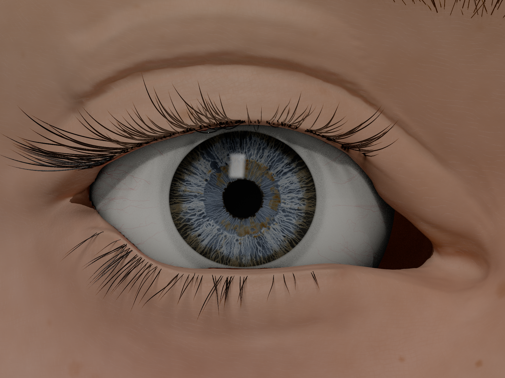

<h1 align="center">Field Studio</h1>

  <b>A mesh-free sculpting, simulation and rendering tool in which every form is an implicit field.</b> 
  First public research release: a dated record of the direction, the mechanisms, what was measured, and what failed.

  
  
  
  
  

  
  
  

**Author:** Mathew Birchard - DCV Systems, LLC - [@birchard_mathew](https://x.com/birchard_mathew)
**Released:** 2026-11-12 20:29 PST (Pacific), as recorded by this repository's first commit and its `v0.1.0-research` release

---

## What Field Studio is

Field Studio represents every form as a signed distance field on a sparse, multi-level lattice: no triangles, no
quads, no tetrahedra anywhere in the model, the tools, the renderer or the tests. Sculpting writes the field;
rendering traces it; contact, posing, hair and cloth read it. The aim is life-like realism at every zoom level, built
from the structure that produces it rather than painted on, in a tool a person uses to finish the work by hand.

This repository is the first public research release. It is published early and unfinished on purpose: a dated
record of what the project is, how each mechanism works, what has been measured, and where it fails.

## What this release is, and is not

- **It is** a research agenda with its demonstrated components, every mechanism labelled with its evidence state.
- **It is not** a claim of novelty. Published ingredients are credited where they are used.
- **It is not** a product announcement. The tool does not yet pass its own first test, and the author's hands-on
  test of the rebuilt toolkit is still to come.
- **It is not** legal advice and claims no patent clearance. Every patent reading in it is a non-lawyer's reading of
  claim text.
- **The code is not in this release.** Parts of it are being redesigned first ([write-up Part 10](docs/research/10-patent-readings-carried-over-and-what-is-held-out-of-the-cod.md)).
  It will be released as open source under Apache-2.0.

## Evidence states

| Label | Meaning |
|---|---|
| proposed | an idea or design; nothing built |
| implemented | built and run; not yet measured against a target |
| measured on named cases | numbers exist, for the cases named, on the machine named |
| reproduced under a frozen configuration | the same result obtained again from a fixed, recorded version of the code |
| accepted in the workflow | the project's current model or daily work is made through it |

Very little has reached the last two.

## A few results, with their scope

| Topic | Result | Evidence state |
|---|---|---|
| Contact read from each body's own distance field, with the published IPC barrier inside an equilibrium Newton solve | Two fingertip pads: 27 s vs 86 s for a standard barrier solver, forces within 1 %. Lips: 16 s vs 27 s. **Reversal:** an eyelid on a rigid eye, 73 s vs 7.4 s. **Unresolved:** a hand on a cheek did not converge in 10 minutes. | measured on named synthetic cases |
| Tools defined by an explicit 3D constraint, not the screen plane | A 30 mm pull along the surface normal gives 29.4-29.9 mm from five views, where the shipped tool gives 30.1 / 17.7 / 5.7 / 0.8 mm. | measured in a lane copy; not shipped |
| Compact encoding of the distance field | 8 bits per value keeps the surface within 5 um with no sign changes, but surface normals miss a 1-degree mark; 9 bits passes (56 % of 16-bit storage). | measured on 5,000 surface bricks |
| Why an elbow stalls near 85-90 degrees | On a stand-in arm, three contact laws stall at similar angles; bones that articulate made it worse while the tissue stays bonded to both. An open question, tested one change at a time. | measured; diagnosis open |

Full conditions, failures and sources are in the write-up.

## Contents

| Path | What it is |
|---|---|
| [`docs/RESEARCH.md`](docs/RESEARCH.md) | The complete write-up, in 11 parts (the canonical record). |
| [`docs/research/`](docs/research/README.md) | The same write-up, one file per part, for reading online. |
| [`docs/disclosures/`](docs/disclosures/README.md) | Dated technical disclosures by subsystem: the author's concepts, the toolkit, the field store and engine, hair. |
| [`articles/`](articles/README.md) | Nine short articles on the same work, each readable on its own. |
| [`images/`](images/README.md) | Single frames of the tool and of the test subject in segments, with their present flaws. |
| [`CITATION.cff`](CITATION.cff) | How to cite this release. |
| [`CHANGELOG.md`](CHANGELOG.md) | Release history. |
| [`LICENSE`](LICENSE) | CC BY 4.0 for the text and images of this release. |

Where to start: the write-up's [introduction](docs/research/00-introduction-and-how-to-read-this.md), or the first
[article](articles/01-field-studio-what-i-m-building-and-why-i-m-publishing-it-unf.md).

## Dates

Times inside the write-up are Pacific time, 2026, and record when something was first stated or built in the
project's own working record. The public date of this material is the release date above, as recorded by this
repository's first commit and its `v0.1.0-research` release.

## Licence and citation

The write-up, the articles and the images are licensed under the
[Creative Commons Attribution 4.0 International licence](https://creativecommons.org/licenses/by/4.0/) (CC BY 4.0);
see [`LICENSE`](LICENSE). Credit: Mathew Birchard - DCV Systems, LLC - @birchard_mathew. The tool's source code is not
part of this release; it will follow under Apache-2.0. To cite this work, see [`CITATION.cff`](CITATION.cff).
