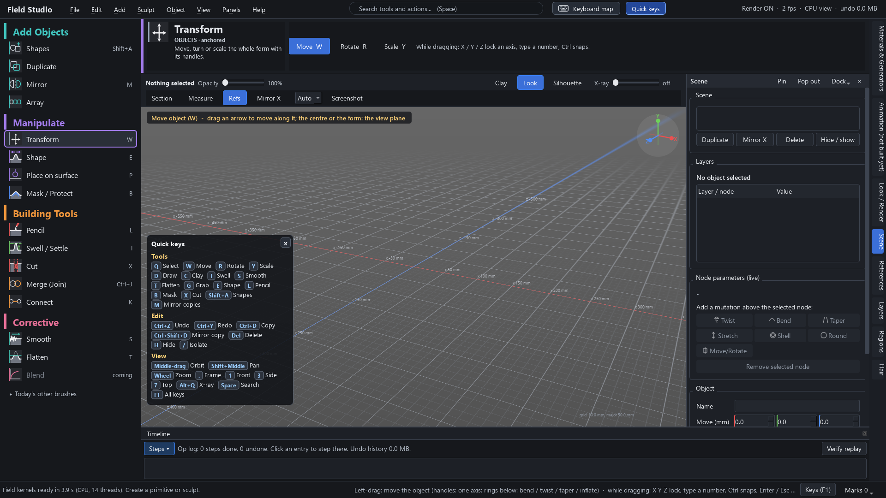
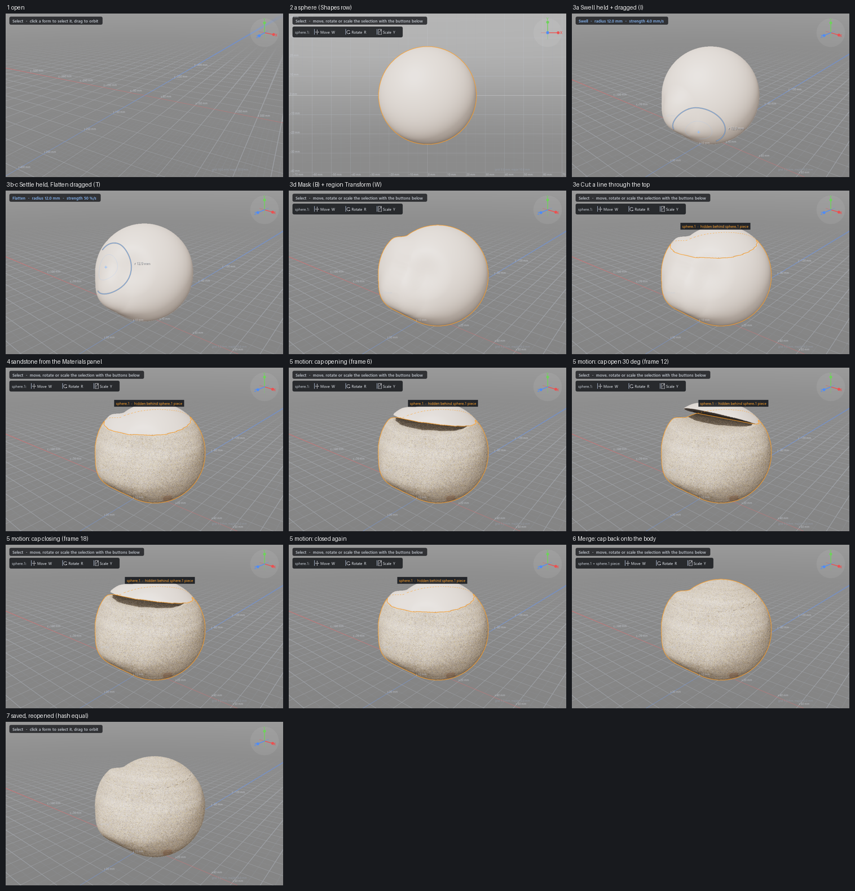

<h1 align="center">Field Studio</h1>

<p align="center">
  <b>An experimental, open-source modeling and sculpting application that brings geometric editing, deformation,
  material appearance, and direct rendering together around a shared implicit representation. Mesh-free throughout.</b><br>
  Second public research release, and the first with code: the tool's source, a measured status review, and a dated
  record of what works and what does not.
</p>

<p align="center">
  
  
  
  
</p>

<p align="center">
  
  
</p>

**Author:** Mathew Birchard - DCV Systems, LLC - [@birchard_mathew](https://x.com/birchard_mathew)

---

## What Field Studio is

Field Studio is an experimental, open-source modeling and sculpting application that brings geometric editing,
deformation, material appearance, and direct rendering together around a shared implicit representation.

It is being built around the act of making: creating a form, shaping it directly, assigning its material, and
arranging it with other objects while seeing the result in the working view. Its tools aim to make their reach,
direction, and effect understandable before and during an edit.

Underneath that interaction, Field Studio represents geometry with spatial functions and locally sampled field data
that describe each object's interior, exterior and surface: negative inside, positive outside, the surface at zero.
Tools change the field, combine it with other geometry, or deform the space in which it is evaluated; the renderer
queries the result directly, on the graphics card (a CPU tracer is the reference and the fallback), to find and shade
the visible surface. There are no triangles, quads or tetrahedra anywhere in the model, the tools, the renderer or the
tests. The aim is life-like realism at every zoom level, built from the structure that produces it rather than painted
on, in a tool a person uses to finish the work by hand.

Development connects engineering work to actual creative use: a stable baseline makes hands-on work possible, and the
difficulties met while making something guide the next improvements.

The first release (`v0.1.0-research`, 2026-11-12) published the research write-up, the mechanisms and their measured
state, without code. This release adds the tool's source, a full status review of where it stands two days later,
the specific research behind it with its measurements, the methods we changed because of patents, and where the work
is going.

> **Research disclosure.** This is a dated public disclosure of our own research and concepts, published while the
> work is under way. Each method was developed with checks for conflicting patents and rights; where a check found a
> conflict, we changed the method ([the methods we changed](docs/PATENT_STORY.md)). This is not a claim of freedom to operate
> and not legal advice.

## What is new in 0.2.0

- **The code** of Field Studio (`engine/fieldstudio/`), the mouth library its Library panel opens
  (`engine/library/mouth/`), the light rig its Light panel drives (`engine/light/`), the hair engine its Hair panel
  grows with (`engine/hair/`, mesh-free), and the material library
  (`engine/materials/profiles/`), under Apache-2.0. See [What the code includes, and what it leaves out](#what-the-code-includes-and-what-it-leaves-out).
- **[The status review](docs/STATUS_2026-11-14.md)**: what changed since the first release, what works with its numbers
  and conditions, seventeen open items, the research direction, eleven findings, the tooling and the methods.
- **[Research, 2026-11-14](docs/research/2026-11-14/README.md)**: the specific research and its findings, measured,
  with images: the material library rendered, contact and motion, hair movement, rain on glass, fabric under weights.
- **[The methods we changed](docs/PATENT_STORY.md)**: where a method we planned turned out to sit near a patent, what
  we did instead, and how the new method measured.
- **[Direction](docs/DIRECTION.md)**: the tools, interfaces and systems we are building and researching, each marked
  current, superseded, ruled out (and why) or not started.
- **[Patent readings](docs/PATENTS.md)**: every patent read against the tool's mechanisms during development, and how
  each mechanism differs, published for transparency. Not legal advice.
- **[The milestone session](tests/milestone_session.py)** and **[the hair session](tests/hair_panel_session.py)** as
  public tests: one modest session, open to close, in the real window; and the Hair panel growing hair on a sphere.
- New images of the tool ([images/v0.2.0](images/README.md)).

## Where it stands, briefly

A head can almost be roughed in with the tool, but not yet finished. The tool does not yet pass its own first
test. Ten of the fourteen tools of the new toolset are usable in the window, none is yet marked proven, and four are not
in the window yet (Shape, Pencil's line tool, the new Smooth, Blend). Pencil is being developed as a surface-following
line tool with shaped tips, controlled depth or height, and progressive on-screen geometry updates; its precision model
distinguishes retracing within a stroke from deliberate additional passes. One scripted session, open to close, passes on the
card and on the CPU; it proves the parts connect, not that a person can do the work. The full account, with every
number and its conditions, is in the [status review](docs/STATUS_2026-11-14.md).

| Evidence state | Meaning |
|---|---|
| proposed | an idea or design; nothing built |
| implemented | built and run; not yet measured against a target |
| measured on named cases | numbers exist, for the cases named, on the machine named |
| reproduced under a frozen configuration | the same result obtained again from a fixed, recorded version of the code |
| accepted in the workflow | the project's current model or daily work is made through it |

## How it works, in brief

- **The representation.** Each object combines an analytic base expression (primitives, geometric combinations and
  supported procedural operations) with a sparse sculpt layer that stores local changes in allocated blocks of samples
  (bricks) on a multi-level lattice, finest level 0.25 mm. For an object with translation `t`, rotation `R` and positive
  uniform scale `s`: `F_local(q) = F_base(q) + ΔF_sculpt(q)`, `q = Rᵀ(p − t) / s`, `F_object(p) = s · F_local(q)`. Values
  are distance-like near the surface; after deformation and sampled edits they are not treated as an exact signed
  distance everywhere. Resolution is finite: fine features depend on sample spacing, interpolation, field maintenance
  and the memory budget.
- **Editing.** A stroke turns pointer input and tool settings into a sequence of field updates: an anchored pull
  responds to displacement, a held tool acts over elapsed time, and a line tool follows sampled positions along the
  cursor path. The engine finds the affected region, evaluates the operation there, updates the field data, and makes
  the result available for display and undo. Reach sets the intended scope of an edit (near side, whole part, through).
- **The warp engine** is the shared deformation machinery: it moves positions through a spatially weighted velocity
  field integrated over the gesture and evaluates the original geometry through the inverse map,
  `F_new(x) = F_old(φ⁻¹(x))`; a divergence-free (curl) variant is designed to preserve volume. Integration steps,
  sampled data and reconstruction leave measured errors; it is not an unconditional guarantee against folding.
- **Field maintenance** restores useful near-surface distance behaviour after edits within a finite band, updates the
  related sampling levels and synchronises changed data; it does not make every stored value a globally exact distance.
- **Materials** provide appearance parameters, procedural composition and stored physical properties; seeded
  generators add reproducible variation (relief, chips, cracks for stone and brick today). Some detail changes the
  geometric field, some only colour or shading, and storing a property such as density does not by itself simulate it.
- **Rendering** traces camera rays against the field, estimates normals, and evaluates material and lighting, with no
  polygon mesh in between. The card holds the sampled geometry in a pooled, multi-level brick atlas; the renderer
  accumulates lighting samples progressively and re-traces only the screen regions an edit changed.
- **Engineering.** Python application code, compiled CPU kernels and card kernels share the scene; ordered processing
  and synchronisation are part of correctness. Undo records keep each step's changed data, move finished steps from
  memory to disk, and are saved with the project, so reopening does not replay the editing session (projects saved
  before 2026-11-14 09:54 PT still replay at open).

## Running it

Developed and tested on Windows 11 with Python 3.12, 32 GB of RAM and an 8 GB NVIDIA RTX 5050. It has not been run on
any other machine or operating system yet.

```
pip install -r requirements.txt
python engine/fieldstudio/run_field_studio.py            # the window, a sphere to start
```

- **The first launch compiles the CPU kernels** (Numba) and caches them beside the code: about five minutes once on
  the development machine under load; later launches open in seconds.
- **Without an NVIDIA card**, or to keep the card free: set `FIELDSTUDIO_GPU=0` and the window draws with the CPU
  tracer (slower, the same field).
- **With the card:** `pip install cupy-cuda13x` (CUDA 13). The card kernels compile on first use (about half a minute
  once).
- `python engine/fieldstudio/run_field_studio.py --selftest` builds a demo scene offscreen and checks it.
- **The milestone session** (about five minutes on the CPU):
  `FIELDSTUDIO_GPU=0 MILE_TAG=cpu_smoke python tests/milestone_session.py`; results in `tests/out/`.

Optional settings: `FIELDSTUDIO_HDRI_DIR` (a folder of HDRI environment folders; the default environment is a neutral
studio generated from a formula), `FIELDSTUDIO_STILLS` (where converged stills are saved), `FIELDSTUDIO_THREADS`.

## What the code includes, and what it leaves out

Included: the whole tool package (the field core, the card and CPU tracers, the warp engine, the toolset, the
materials engine, the hair engine and its drawing layer, the window), with its CUDA sources compiled at run time.
One known limit: the hair's optional fibre light needs a precomputed far-field table that is not in this release
(`FIELDSTUDIO_HAIR_TABLE_A` names one); without it the hair is lit by the lattice light.

Left out of this release, each for a stated reason (the release manifest lists every file):
- **On patent grounds** ([docs/PATENTS.md](docs/PATENTS.md)): the earlier line tool (the current Pencil is in),
  Connect along a curved path (straight connectors are in), and an earlier tagged storage layout the app never used.
- **The human test model's data and the tests that use it.** The model stays private; the tool opens a field store
  only if one is given.
- **Garments** (`engine/cloth`) and the **contact solver**: not part of the window's tool path today.
- **A full-detail still renderer** tied to the private model. The window's own converged still (Render > This view,
  converged) is included.

## Contents

| Path | What it is |
|---|---|
| [`engine/fieldstudio/`](engine/fieldstudio) | Field Studio: `run_field_studio.py`, and the `fieldstudio` package (core, gpu, toolset, warp, materials, render, hair, tools, ui). |
| [`engine/library/mouth/`](engine/library/mouth) | The mouth library (teeth, gums, tongue, jaw) as fields, with cited default dimensions. |
| [`engine/light/`](engine/light) | The light rig the Light panel drives. |
| [`engine/hair/`](engine/hair) | The hair engine: grow, style and settle hair as fields and curves (mesh-free). |
| [`engine/materials/profiles/`](engine/materials/profiles) | The material library (stone, brick, wood, glass, metal, fabric, ground, water, and human tissues): each value with its source. |
| [`tests/`](tests/milestone_session.py) | The milestone session and the hair session. |
| [`docs/STATUS_2026-11-14.md`](docs/STATUS_2026-11-14.md) | The status review of this release. |
| [`docs/research/2026-11-14/`](docs/research/2026-11-14/README.md) | The research of this release, measured, with images. |
| [`docs/PATENT_STORY.md`](docs/PATENT_STORY.md) | The methods we changed because of patents, and how they measured. |
| [`docs/DIRECTION.md`](docs/DIRECTION.md) | What we are building and researching, by status. |
| [`docs/PATENTS.md`](docs/PATENTS.md) | Patent readings, for transparency. |
| [`docs/RESEARCH.md`](docs/RESEARCH.md), [`docs/research/`](docs/research/README.md) | The first release's write-up, in 11 parts. |
| [`docs/disclosures/`](docs/disclosures/README.md) | The first release's dated technical disclosures by subsystem. |
| [`articles/`](articles/README.md) | Nine short articles from the first release. |
| [`images/`](images/README.md) | Frames of the tool and of the test subject in segments. |
| [`NOTICE`](NOTICE), [`docs/DATA_SOURCES.md`](docs/DATA_SOURCES.md) | Dependencies and data sources with their licences. |
| [`CHANGELOG.md`](CHANGELOG.md), [`CITATION.cff`](CITATION.cff) | Release history; how to cite. |

## Dates

Times in the documents are Pacific time, 2026, and record when something was first stated, built or measured in the
project's own working record. The public date of this material is the date of its commit and release in this
repository.

## Licence, patents and citation

The source code (`engine/`, `tests/`) is licensed under the [Apache License 2.0](LICENSE), except three light
data files that carry a CC BY-SA 4.0 excerpt (named in [`NOTICE`](NOTICE)). The write-up, documents,
articles and images are licensed under the [Creative Commons Attribution 4.0 International licence](LICENSE-CC-BY-4.0)
(CC BY 4.0). Credit: Mathew Birchard - DCV Systems, LLC - @birchard_mathew. Third-party dependencies and data sources
are listed in [`NOTICE`](NOTICE). The patent readings in [`docs/PATENTS.md`](docs/PATENTS.md) are engineering readings
by non-lawyers, published so the differences are on record; they are not legal advice and not a freedom-to-operate
opinion. To cite this work, see [`CITATION.cff`](CITATION.cff).

Copyright 2026 Mathew Birchard - DCV Systems, LLC.
