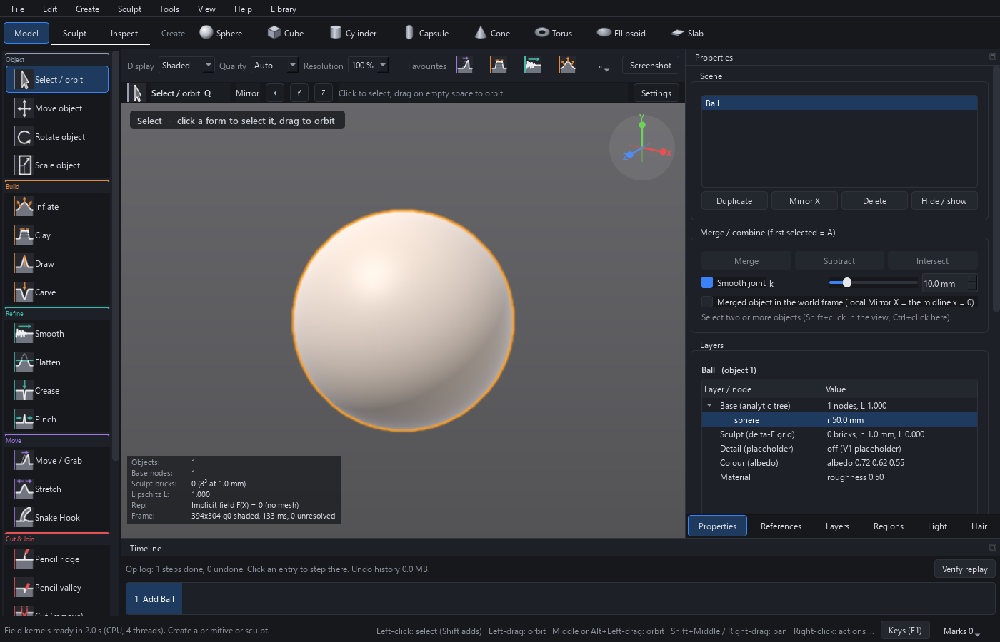
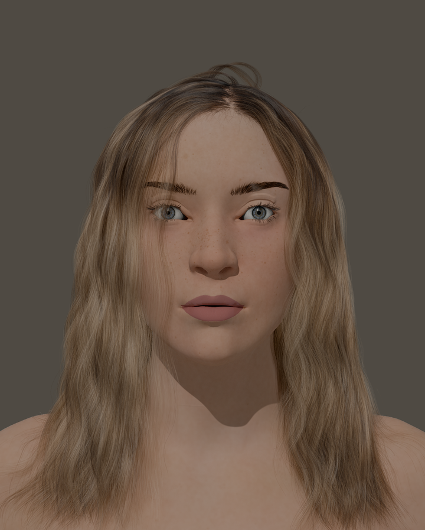

# 1. Field Studio: what I'm building, and why I'm publishing it unfinished

*By Mathew Birchard - DCV Systems, LLC - @birchard_mathew*

Field Studio is a sculpting, simulation and rendering tool with no meshes in it. No triangles, no quads, no
tetrahedra: not in the model, not in the tools, not in the renderer. Every form is an implicit field, a signed
distance stored on a sparse lattice at several levels of detail, 0.25 mm at the finest today. Hair is curves.
Cloth is yarn points. Contact, posing and light are computed on the fields directly.

The aim is realism that holds at any zoom, on one ordinary desktop: 32 GB of RAM and an 8 GB RTX 5050. And a tool
a person can finish work in by hand, quickly.

It isn't finished. The first test I set for it is plain: turn a sphere into a rough head in under five minutes.
It doesn't pass yet. The first scripted run made a lumpy egg with a flat face, and when I
sat down to sculpt on November 12 I couldn't block out a head with the tools as they were. That sent the whole
toolkit back for a rethink, which is article 3.

So why publish now? Because the direction, the research it stands on, the methods, and the measured state are
worth having on the public record with a date, failures included. The full write-up describes each mechanism
closely enough to rebuild it, credits the published work each part learned from, and labels every item by how
much evidence it has: proposed, implemented, measured, reproduced, or accepted in daily use. Very little has
reached the last two.

The code will be open source. It isn't in this first release, because while reading patents we found a few
places where our code needs a different design first (article 8).

Write-up: https://github.com/dirtcodevet/field-studio

*Prepared November 12, 2026.*

---
[All articles](README.md) | [The write-up](../docs/RESEARCH.md)
