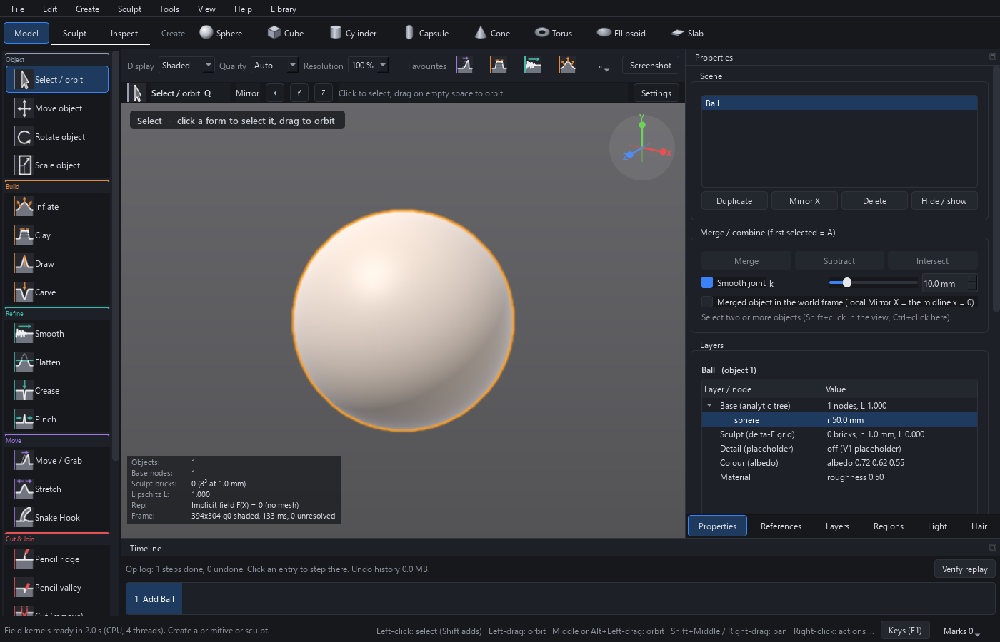

# 3. A mouse drag is not a 3D stroke

*By Mathew Birchard - DCV Systems, LLC - @birchard_mathew*

On November 12 I tried to block out a head in my own tool and couldn't. One reason turned out to be simple to
state. A mouse moves in two dimensions. A sculpting stroke is three-dimensional. Something has to supply the
third dimension, and if that something is the camera, every tool behaves differently from every angle.

Measured: pulling a surface out by 30 mm gave 30.1 mm when viewed square-on, 17.7 mm at 30 degrees, 5.7 mm at 60
degrees and 0.8 mm at 80 degrees. Same drag, four different sculptures.

So the toolkit is being rebuilt on a rule: once the stroke and its 3D constraint are set (along the surface
normal, in a tangent plane, along an axis, on one part), changing the camera does not change the operation. The
constraint comes from the form and is drawn on screen. In a test copy the same 30 mm pull now gives 29.4 to
29.9 mm from every angle, and an out-and-back wiggle returns to 0.00 mm.

Two more rules came from sculpting experience rather than from code:

A brush changes only the sheet of surface under it. In a test with a 4 mm wall and a ball 2 mm behind it, the old
default moved the back of the wall and the ball behind it by millimetres. Nothing behind a thin wall should
move unless you ask for it.

Some tools exist in mesh sculpting only because of the mesh. In a field you can add material without adding
vertices, so not every familiar tool needs a twin here.

The rebuilt toolkit hasn't had its hands-on test yet. That's the next benchmark, and I'll report how it goes.

Write-up: https://github.com/dirtcodevet/field-studio

*Prepared November 12, 2026.*

---
[All articles](README.md) | [The write-up](../docs/RESEARCH.md)
