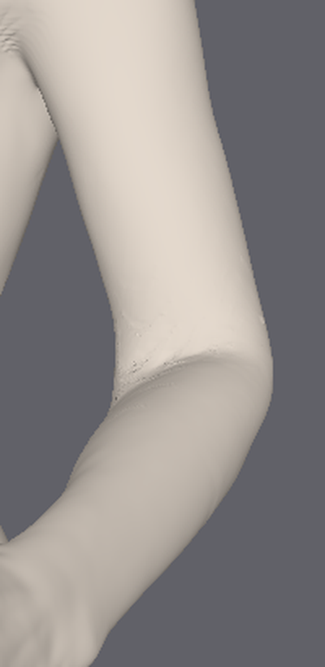
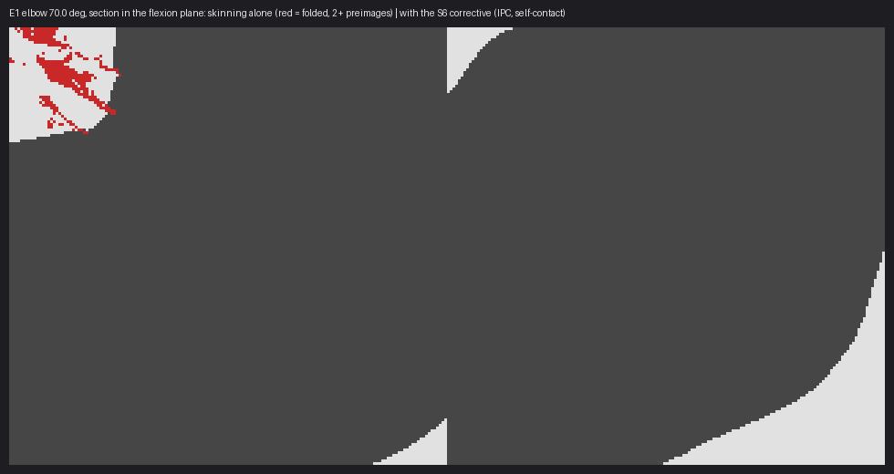

# 5. Why does the elbow stop at 85 degrees?

*By Mathew Birchard - DCV Systems, LLC - @birchard_mathew*

A real elbow bends to about 145 degrees. On a simplified test arm ours stalls between 85 and 90 (measured from
straight), and what makes it interesting is that it stalls there under three different contact methods.

When three methods fail at the same place, the cause is probably upstream of all three. Probably. The three runs
also share the geometry, the material model and the lattice, so that isn't a diagnosis yet.

What has been measured so far: where the strain energy sits at the stall. 44 % is in the front crease. 22 % is in
a 22 mm plug of soft tissue between bone ends that, in the test arm, don't articulate the way a real joint does.
Measured on anatomical cross-sections, the real flexion axis lies about 36 % of the arm's depth from the back
skin.

Two tests of single causes have come back negative: bones that articulate at the real axis did not move the stall, and
neither did making fat as soft as the literature says. The lesson from the first: articulation needs sliding. So
the current plan treats the skin as its own sliding sheet, on the human model's real arm, with a finer 2 mm crease
as the control. A first run on that real arm reached 90 degrees from its rest pose (about 112 anatomical), with
the solver at its limits.

Posing itself uses published methods on the lattice: bone-heat weights (Baran and Popović 2007) solved through the
volume, and dual-quaternion blending (Kavan et al.). Skinning alone folds the inside of the elbow at every
setting, which is why the joint zone is solved with contact and stored as a corrective. That corrective, an earlier and
separate setup, reaches 55 degrees on the human model, with visible defects in the crease.

Write-up: https://github.com/dirtcodevet/field-studio

*Prepared November 12, 2026.*

---
[All articles](README.md) | [The write-up](../docs/RESEARCH.md)
