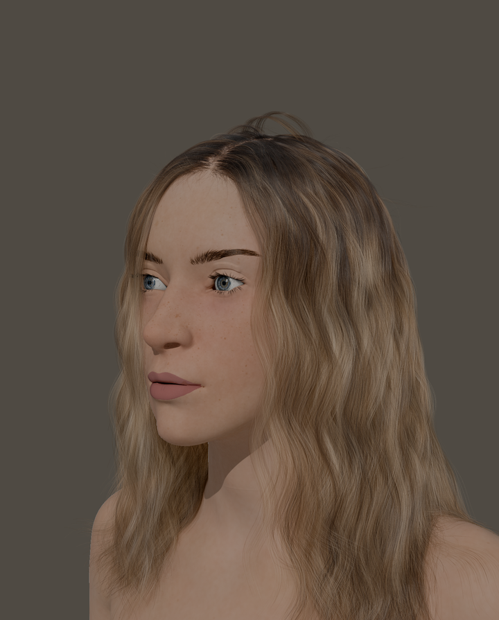
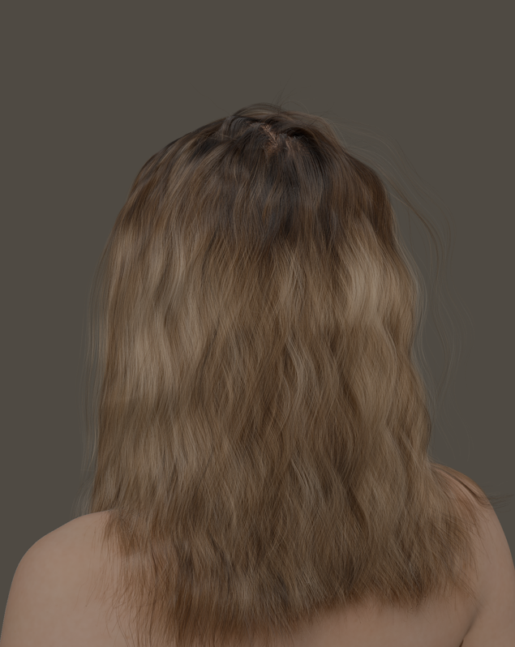
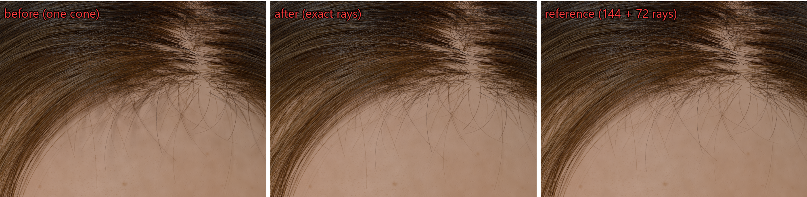

# 6. Hair: grow it once, then style it

*By Mathew Birchard - DCV Systems, LLC - @birchard_mathew*

An earlier attempt at hair in this project failed and was archived. A later one looked good until I looked
closely: a mound, with locks all the same size. An audit then found real faults underneath the look.

The rebuild starts from how hair actually gets its shape. Each fibre grows from a follicle with its own exit
angle and its own inherited curl, a helix. The head is grown once and settled under its own weight until it
passes a rest test. That grown head is the natural base. Styles come afterwards as states applied to it:
brushing, a hand, product, water, a tie. Different kinds of hair (scalp, hairline, brows, lashes, fine facial
hair) are different kinds with their own properties.

One fault is worth telling. The waves lined up in horizontal bands around the head. The cause was a phase shared
across 35 mm sections, as if the whole head had dried in step. The fix gives each lock its own phase, loosely
tied to its neighbours within about 8 to 15 mm. Measured: the correlation between waves on far-apart parts of the
head went from 0.12 to -0.01, and the even bands no longer appear on the comparison sheet. The fix itself then caused a new defect (loose strands at the
crown went from 104 to 326, where about a dozen are intended), which was traced and fixed in turn.

The fibres are shaded with published models (Marschner et al. 2003, Chiang et al. 2016), and the hair's shadow on
the skin is traced with real rays, checked against a 144-ray reference.

Not done: motion. Today the hair is statics only. Growing a head takes about 6.5 minutes on the card.

Write-up: https://github.com/dirtcodevet/field-studio

*Prepared November 12, 2026.*

---
[All articles](README.md) | [The write-up](../docs/RESEARCH.md)
