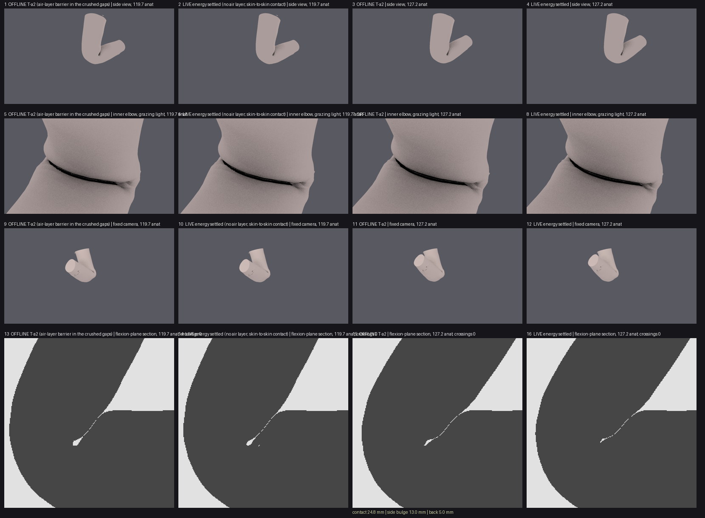
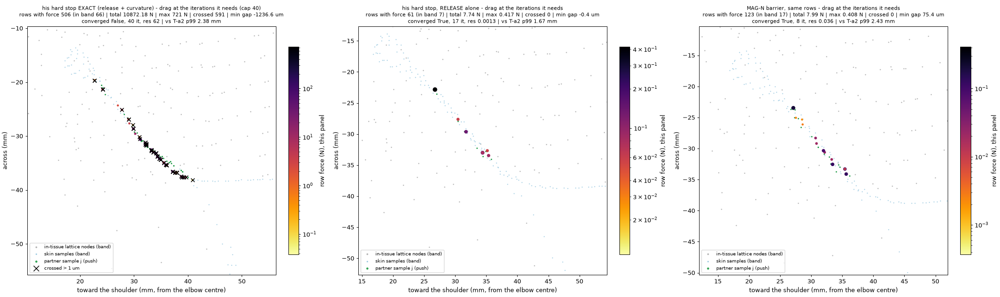
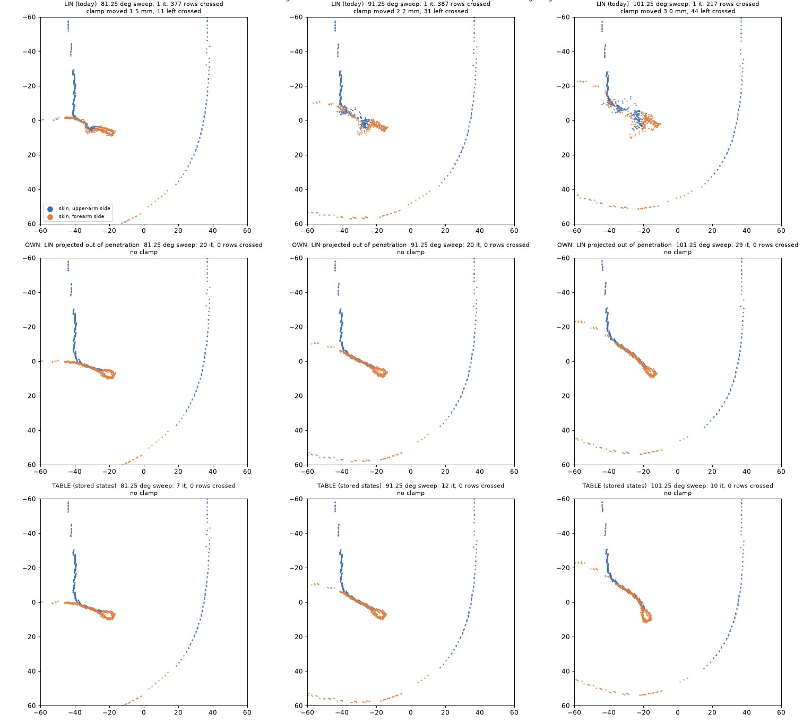
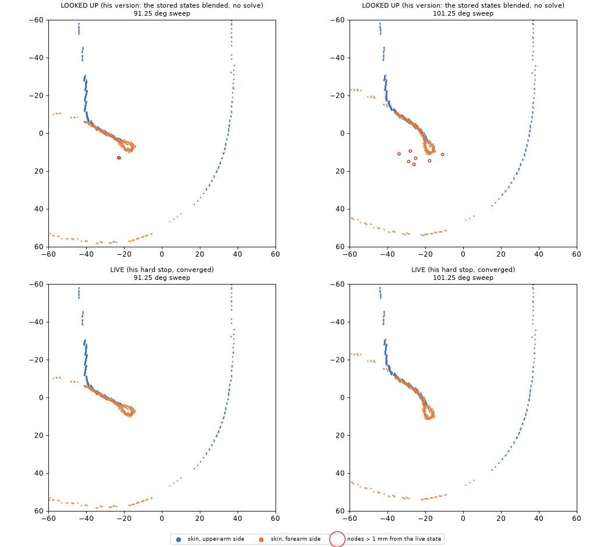
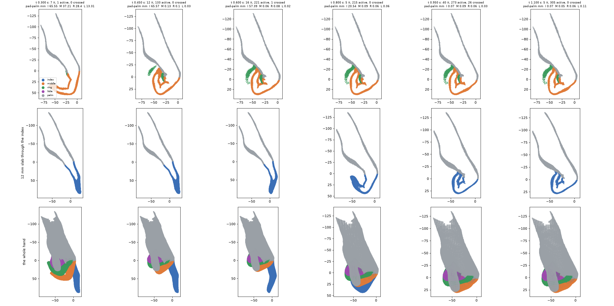
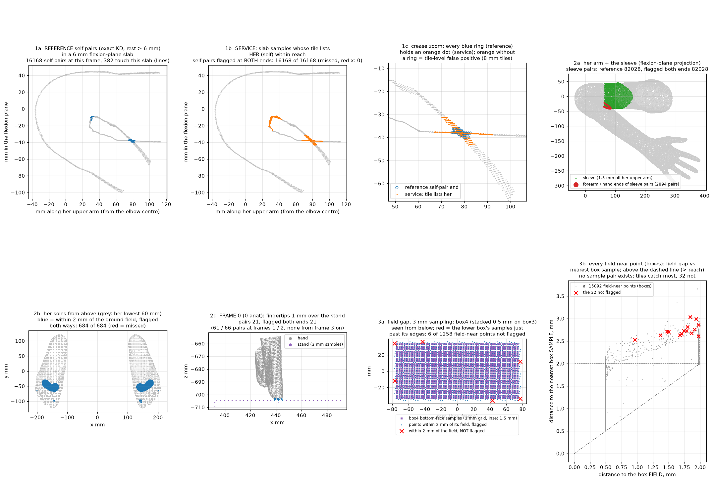
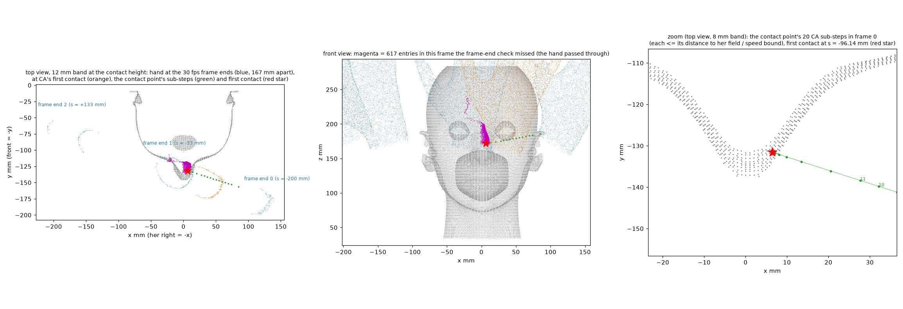

# Contact and motion: the elbow, the hard-stop law, warm starts, the fist, and six concept tests

Research record, 2026-11-12 about 20:00 PT to 2026-11-13 about 20:05 PT. Licence CC BY 4.0 (text and the images listed
here, all our own plots and renders).

The first release published the contact work up to 2026-11-12 evening: the barrier baseline, the constraint solver
prototype, the author's concept of contact acting like a magnetic field, the environment-field proposal and the first elbow study
([RESEARCH.md, Part 6](../../RESEARCH.md)). The status review gives this period in brief
([STATUS_2026-11-14.md, sections 4.5 and 4.6](../../STATUS_2026-11-14.md)). This file records it in full, with the
failures. On 2026-11-14 the contact and motion lanes were paused at clean hand-offs by decision, so that the
tool's baseline comes first.

**Two caveats that apply to everything below.**

1. Every result was produced in working copies of the contact code. **None of it is in Field Studio's window**, and none
   is accepted in the workflow. The highest evidence state reached is *measured on named cases*. Evidence states used:
   *proposed*, *implemented*, *measured on named cases*, *reproduced under a frozen configuration*, *accepted in the
   workflow*.
2. Every elbow angle on the human test model's arm rides a skeleton that was later found defective: its hinge axis was
   square to the upper-arm bone, and its elbow centre sat about 27 mm too high. The tissue and contact findings stand;
   the angles and the crease's position need re-running on a corrected skeleton. On that arm, the anatomical angle is the
   sweep plus 22.2 degrees (the model rests slightly bent).

---

## 1. The elbow on the human test model's arm

The first release left the elbow stalling near 85-90 degrees, cause not established, with the test just moved from a
stand-in arm to an isolated elbow region of the human test model's own field ("E2"). Overnight (2026-11-12 20:38 to
2026-11-13 09:22 PT) three causes were measured, each fixed in the working copy:

| Cause | How it was measured | Fix |
|---|---|---|
| **Newton capped by a too-stiff Hessian.** The projected (Gauss-Newton-type) Hessian is about 12 times stiffer than the true one along a forming fold (Rayleigh quotient 0.086). | With the true Hessian the stalled step converged in 30 iterations; with the projected one it hit the 80-iteration cap. | Newton with the exact tangent (2026-11-12, 23:46-23:50 PT). |
| **The step's starting guess.** The skinning predictor placed skin inside skin, so each step started infeasible. | Starts measured infeasible from 80 degrees of sweep. | A spring-held soft start. |
| **Skin into tissue near the apex.** Past about 127 degrees anatomical, contact rows built on tangent planes let skin slip into the neighbouring tissue. | Counted with an independent volume-map self-check. | The signed self-check as a constraint: 0 crossings on the stand-in arm at 100 and 102.5 degrees, at 17-34 minutes a step. |

**How far it bent.**

- With the exact tangent and the soft start the arm reached **144.7 degrees anatomical**, but with 23 real crossings up
  to 2.18 mm: the angle was reachable, the contact was not clean. Not counted.
- The clean run (with the self-check) **failed at 107.2 degrees** (2026-11-13, 02:45 PT). The kink behind it was traced
  through three layers, each fixed: a continuity gap across cell faces in the volume map, a finite-difference gradient
  on the rest field, and a hard switch in the rule for a point's own neighbourhood. What remained was a crushed 4 mm cell
  at the apex: a limit of the representation at that cell size.
- The first sheet of the bent arm was judged stiff and lifeless on review: no visible compression of the
  skin. Two structural experiments followed, with marks written first. Softer fat and muscle at literature values
  (5 and 15 kPa) did not produce the side bulge. **The skin's own in-plane stiffness (657 kPa) acting in parallel over the
  soft bulk did** (10.6 mm of side bulge at 89.7 degrees, meeting the mark) and carried the arm cleanly to **129.7
  degrees anatomical** (crossings checked to 127), well past the clean run's 107. The contact length at 127.2 degrees
  was 24.8 mm against a mark of at least 32. A wall near 130 degrees is not diagnosed; the 145-155 degree target is
  not reached.
- Skin as a separate sheet over the tissue (so it can slide) stalled at 52 degrees anatomical on this arm.

**Experiments that did not move the stall**, each with its mark written first: bones that articulate at the axis (the
start went infeasible from 45 degrees of sweep, and a 70-degree step took 421 s against 102 s); a damped inverse cell map
(a real energy-jump fault, fixed, but the wall did not move); 2 mm cells in the crease on the stand-in arm (the wall came
earlier, 67.5 against 82.5 degrees; later flagged as confounded by other settings, to be re-run).

**A neural predictor as the step's start** (2026-11-13, 02:57-03:46 PT): trained on solved states, its one-shot starts
were infeasible every time (a start must land within about 20-40 um), so it failed as a solver start; it produced 0 real
crossings as a preview. Useful for previews, not for starting the solve.

*The human test model's left arm, isolated, at 119.7 and 127.2 degrees anatomical: the offline solve with the skin's
in-plane stiffness (columns 1 and 3) against the live layer's own settled state (columns 2 and 4). Rows: side view,
inner elbow under grazing light, a fixed camera, and the flexion-plane section (0 crossings at 127.2 degrees; contact
24.8 mm). Drawn by the bench tracer, not the tool's renderer, from a 4 mm lattice. A row of reference photographs in the
original sheet is cropped out. Evidence: measured on named cases.*

## 2. Sliding skin: open

The mark for a bending elbow is that the skin over the crease does not slide along the arm (about zero axial
slide). On the stand-in arm, skin as its own sheet converged from 0 to 35 degrees with the crease region sliding 4.8 mm
and failed that mark (1.23 mm against a limit of 1 mm at the measured point); two further runs stalled or were paused.
Tethers built from measured skin data were never run. **Open.**

---

## 3. Movement first, with one contact rule for every body

On 2026-11-13 at 09:09 PT the work was redirected: movement first, with **universal contact** (one rule for every
pair of bodies, a body's own other tissue included), and deformation parked. Three research reports were written
(joints, a live surface, real-time contact), and a *live layer* was built: one solve per drawn frame.

- **Joints.** A joint engine reads the older skeletons and poses them identically (largest difference 5.6e-16).
- **A frame without contact settles in one Newton iteration**: 0.055 mm to 0.034 mm at the 99th percentile, on 2.5-degree
  frames (a 2.5-degree step at 60 frames a second is a 150 degree-per-second drag).
- **Where the crease closes, every analytic starting guess misses by 1-4 mm.** A separate test showed that miss is the
  tissue's response to contact, not interpenetration: the frame needs a real solve.
- **The live contact term** (12:26 PT): one smooth gap per pair of skin samples, with normals carried by the deformation
  (cofactor of the deformation gradient applied to the rest normal); the pair set is frozen per frame and kept across
  frames; its gradient matches finite differences to 1e-8.

---

## 4. The hard-stop law

**The idea** (one of the author's concepts): zero force while surfaces are apart, never crossing, never pulling; force only where
they meet. The barrier compared against it pushes before contact (bodies rest at small positive gaps); a penalty pushes
while apart and allows crossing.

| Step (2026-11-13, PT) | What was tested | Result |
|---|---|---|
| g3, 13:23 | the hard stop, a penalty and the barrier on the same crease frames | only the barrier held at first (0 crossed, 5-17 iterations a frame); the penalty pushed 15-155 N while apart; the hard stop written as a complementarity (Fischer-Burmeister) step failed as a *method* (duplicated ordered rows), not as a law |
| g3b, 13:41 | one row per unordered pair, on the projected tangent | 0 crossed, gaps 0 within 1 um; but small forces (1.6e-6 to 1.4e-2 N) on rows that were apart; 11-22 iterations against the barrier's 4-10 |
| g3c, 14:01 | the active-set release alone (a row's multiplier must stay non-negative; a row is released when it would pull) | **exact as a law**: force only on rows touching within a micron; 61 rows carry 7.74 N where the barrier needs 123 rows held 75 um apart. Adding the constraint curvature term diverged |
| port, 14:07-14:30 | the law in the live layer as a primal-dual active-set (PDAS) solver, with hysteresis (1e-7 m, 1e-3 N) and a counted end-of-frame clamp | a drag from 85 to 127 degrees anatomical: 0 crossings on every drawn frame of its 2.5-degree grid; 4 iterations off the crease, 12-23 through it, 38-40 at the deepest; the clamp acted on 2 of 17 frames, at most 26 um |
| 16:04 | an augmented Lagrangian form of the same law | 574 inner iterations against the PDAS's 317 (1.81 times), with forces at a distance (0.03-0.95 N) from lagging outer updates; the PDAS was kept |
| g3d, 17:55-18:20 | iterations, hard stop against the barrier, with different starts | see below |

| Start | Frames | Hard stop | Barrier |
|---|---|---|---|
| stored table (section 5) | 5-degree | 57 | 97 |
| stored table | 2.5-degree | 99 | 109 |
| its own start, nothing stored | 5-degree | 123 | 88 |
| its own start | 2.5-degree | 254 | 74 |

With its own start the hard stop needs 1.4-3.4 times the barrier's iterations; with stored starts it needs fewer. The
barrier needs a feasible start and fell back to the last state on about 90 % of frames. Wall time favoured the PDAS,
an effect of the implementations rather than of the laws.

*One crease frame of the elbow in a 6 mm flexion-plane section, row forces coloured on a log scale. Left: the hard stop
with the curvature term (diverged, 591 rows crossed). Centre: the hard stop by active-set release alone (61 rows carry
the load, 0 crossed, gaps within a micron). Right: the barrier on the same rows (123 rows, 75 um apart). Evidence:
measured on named cases.*

---

## 5. Warm starts: caching solved states

**The idea:** store the law's own solved states along a movement once, and start each new frame from them.

**The caching test** (16:17 PT). A table of the live law's states every 2.5 degrees from 65 to 105 degrees of sweep
(17 entries, 3 MB), used only as a starting point; the law still solves every frame.

- Between table entries: 99 iterations against 351 for a linear-predictor start, 0 crossed, no clamp.
- On 5-degree frames the linear-predictor start broke (124-656 rows crossed; the clamp moved skin 1.5-3.7 mm); the table
  held.
- Unbending: 181 iterations from the table.

**A start with nothing stored** (OWN-1, 16:49 PT): the linear predictor projected out of penetration. A 5-degree bend took
123 iterations over 8 frames, every frame converged, 0 crossed (about 2.2 times the table); unbending 185; across three
tissue settings (fat 2 and 15 kPa, dermis 300 kPa) 122-153 iterations, where the plain linear start failed all three.
Rejected after measurement: carrying the trust radius between frames (169), seeding only the active set (no gain), and a
tight linear start (holds at about 7 times the table's cost).

**Stored states applied directly, with no solve** (the concept's original form). Blending the two nearest stored states: 0.01-
0.05 mm from the live solve at the 99th percentile off the crease; 0.05-0.89 mm in the crease, with 8-36 rows crossed by
4-35 um; about 1 ms a frame on the card (an estimate, not measured). Applying the single nearest state instead **failed**
at 2.5-degree spacing (73-600 rows crossed by 0.5-1.0 mm). A reachable-state lookahead was proposed and not measured.

The stored-state work is research only and is not in the released code.

*Skin samples in the flexion plane (upper-arm side blue, forearm side orange) on 5-degree frames at 81.25, 91.25 and
101.25 degrees of sweep. Top: the linear-predictor start (377, 387 and 217 rows crossed; the clamp moves skin 1.5-3.0
mm). Middle: the projected own start (0 crossed). Bottom: the stored table as the start (7-12 iterations, 0 crossed).
Evidence: measured on named cases.*

*The crease looked up from blended stored states (top) against the live solve (bottom) at 91.25 and 101.25 degrees of
sweep; red circles mark nodes more than 1 mm from the live state. Evidence: measured on named cases.*

---

## 6. The live solve on the graphics card

- The live element on the card equals the CPU to 1e-15; the contact rows equal it to round-off, 0.3 ms for 2,470 rows.
- The linear solver is the lane's own smoothed-aggregation multigrid (3 levels, operator complexity 1.30, 0.3 s of CPU
  setup) with a projected conjugate gradient for the active rows: 23-45 iterations to 1e-3 at 70-85 degrees. The deep
  crease (195 nearly dependent rows) takes 113-241: open.
- On the card in single precision one iteration costs 0.30 ms launched as a recorded graph against 2.1-4.9 ms launched
  plainly.
- **Estimated** frame times from those parts: crease frames about 70-90 ms with the table start and about 150-380 ms with
  the own start, against 16.7 ms for 60 frames a second; frames without contact about 10 ms. Not measured end to end.

---

## 7. The hand and the fist

The live layer was made region-agnostic (nothing elbow-specific) and reproduced the elbow (131 iterations against 123),
then moved to the hand.

- **First runs failed on the skeleton:** the thumb's joints were defective, and bone capsules meeting at the finger
  joints pinned nodes, so a refined 1.5 mm run diverged. Fixed with gaps at the joints.
- **A fingertip blow-up** was traced to a pre-step started from rest; after the fix a light curl took 7 iterations over 5
  frames with 0 crossed.
- **The finger crease:** the skin's trough pinches within one cell at any cell size (1.5 mm cells did not cure it). The
  fix is material-driven, a "skin hinge": no contact rows between skin points closer than twice the skin's thickness
  (3.1 mm) at rest. With it every frame from 0 to 0.6 s converged.
- **The fist, closed by contact** (2026-11-13, about 20:00 PT): the curl timed from a reference video of a hand
  closing, 3 mm cells, a composite fist (knuckle 90, middle joint 110 degrees, end joint 0.55 of the middle). All four
  finger pads reached the palm (0.02-0.1 mm), at 70-80 % of each finger's curl (in the video, 85-90 %). 582 iterations
  over 66 frames, 37 minutes on the CPU.
- **Open:** after the clamp, 3 rows up to 0.37 mm remain at 0.87-0.93 s; line searches fail from 0.47 s; the press grows
  to about 126 N. The next step, a movement stopped by contact rather than by a set angle, was not started.

*The human test model's left hand at six moments of the curl (0.30-1.10 s), as sample points: a section through the
fingers, coloured by finger (top), a 12 mm slab through the index finger (middle) and the whole hand (bottom). The
panel titles give iterations, active rows, crossings and each pad's distance to the palm. Evidence: measured on named
cases.*

---

## 8. The contact field, and the six concept tests of 2026-11-13

**The environment field as the contact sensor.** The first release proposed a value held in the space between bodies
that reports where anything approaches anything, so candidate pairs are found without pair searches. It was built and
measured in steps:

- *Sensor b* (2026-11-12, 20:37-22:17 PT): it found every contact row the reference pair search found, in every run. At
  rest it cost 0.05-0.07 of a full search; with one body moving among 8, 24 or 48 resting bodies, 0.79, 0.39 and 0.26;
  inside a joint sweep, parity.
- *Hybrid c* (23:18 PT): forces unchanged and 0 crossed with no lost rows; parity on soft-on-soft scenes; slower on a
  lid against a rigid eye; the cheek scene did not converge.
- *Object box e* (2026-11-13, 00:06 PT): moving an object's key rewrites no stored brick (frame time within 1 %); skipping
  by distance alone was slower.

**The six concept tests.** On 2026-11-13 a research lane tested six of the author's concepts from the first release,
with pass marks declared before each run. The status review has the table; the details it leaves out are here.

| Concept | Verdict | Numbers, and what the short version omits |
|---|---|---|
| Compact encoding as a display cache (8-bit companded bricks) | **No** | memory 0.515 of the 16-bit read, but each pass 1.58-1.76 times slower against a mark of 1.05; it also failed one image mark on the lips |
| Persistent state advanced only when needed (lazy) | **Correct, No on cost** | lazy against fully stepped truth over 600 s: 0.0067 K and 0.026 g/m2; the faster variant still took 39.6 % of the eager time against a 25 % mark |
| A field through the environment as a shared broad phase | **Yes, with a qualifier** | 0 missed of 14.3 million reference pair-frames; 0.0022 of a full search at rest, about 0.13 with one limb moving; 49.5 bytes a tile. Exact against sample pairs, not against the bodies' own fields: with 3 mm sampling 32 of 15,092 field-near points (0.2 %) were not flagged |
| Sensing contact by probes | **Yes by its marks** | every feature at least twice the base spacing found in all 13 frames, at 0.0001-0.0035 of the direct field evaluations; but in wall time the probes cost 0.22-0.49 of direct (bookkeeping), the saving came from caching in the object's own frame, and every fine feature tested came from an analytic bowl |
| Fast motion without missed contact (conservative advancement on the fields) | **Yes** | 0 missed at 0.5-5 m/s, 30 and 60 frames a second, three frame phases; 0.20-0.47 ms a frame on the card (the packaged kernel verified at 0.58 ms worst frame). A frame-end check of the same motions missed 2.6-98 % of the entries against a face, 0.1-11 % against a thigh and 87-100 % against a 1 mm sheet |
| Material-first layered skin (folds from the layers' own law) | **Neither** | volume error at most 0.009 %, 31 times smaller than the brick format, no drift after 100 cycles; but the folds came out as a regular corrugation, like tooled leather, not skin. It also re-derived a strain law the project already had |

Evidence state for all six: measured on named cases, one machine, one run each unless stated.

*The environment-field test at 145 degrees anatomical, as points: self-pairs at the elbow crease found by the field
(orange) against the exact reference (blue; 0 missed), a sleeve on the arm, the soles against the ground, fingertips
over a stand, and the qualifier (3a, 3b): with 3 mm sampling, points within reach of a box's field but with no sample pair
are not flagged (32 of 15,092). Evidence: measured on named cases.*

*A hand swiped into a cheek at 5 m/s and 30 frames a second, as points. Left: top view of the hand at three frame ends
(blue, 167 mm apart), at the first contact found by conservative advancement (orange) and its sub-steps (green). Centre:
front view; magenta marks the 617 entries in this frame that a frame-end check missed. Right: the 20 sub-steps of one
contact point. The centre panel shows the human test model's head as a sparse point cloud. Evidence: measured on named
cases.*

---

## 9. Patent readings for this work

Engineering readings by non-lawyers; not legal advice and not a freedom-to-operate opinion. The full table is in
[PATENTS.md](../../PATENTS.md).

- **The hard-stop law** against position-based dynamics (US 7,616,204): the static solve has no velocities and no
  predicted positions that are then corrected. Against XPBD (US 11,270,041): the multipliers are hard, with no compliance
  tied to an elastic energy. Against US 12,216,969 (energy minimisation in a primal formulation with a preconditioned
  descent): the law is solved as constraints with tracked multipliers in a primal-dual active-set method. A continuation
  of that family is pending (US 2025/0131161) and is watched; if inertia is added, the unknowns stay at the velocity level.
- **Stored solves as warm starts** against Tencent US 11,823,315: what is stored is the same law's solution, used as a
  starting point for that law, not poses blended by distance weights. The direct application of blended stored states
  (section 5) is research only and is not in the released code.
- **Open:** a reading of Disney US 9,135,738 against the live element's one-point quadrature.

## 10. What this file does not establish

- Any of it in Field Studio's window, or in its released code.
- The full elbow (145-155 degrees anatomical), or the angles above on a corrected skeleton.
- Skin that slides correctly over a bending joint.
- Real-time frame rates with contact: the card timings are parts, and the frame times are estimates.
- A fist as a movement stopped by contact (the fist above reaches a set curl).
- Repeated measurements: nearly every number is one run on one machine with other jobs running.
