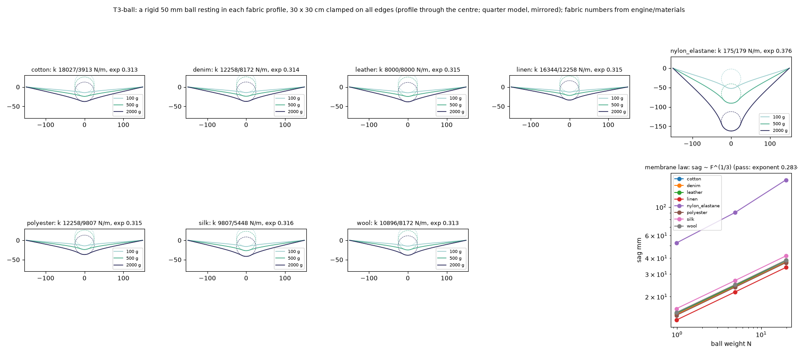
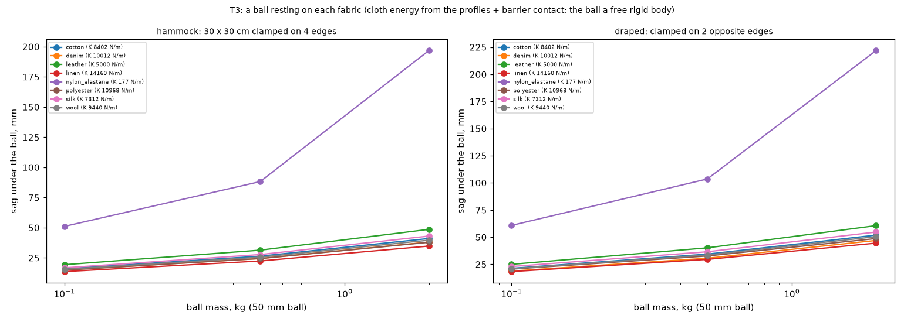
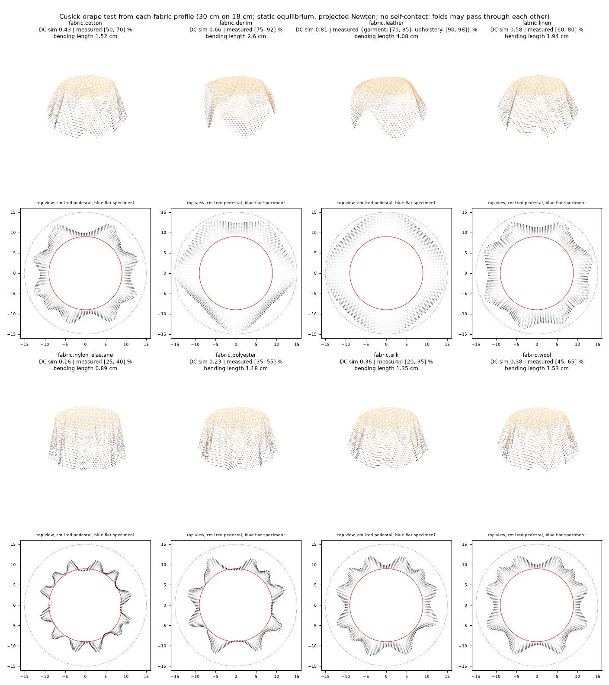
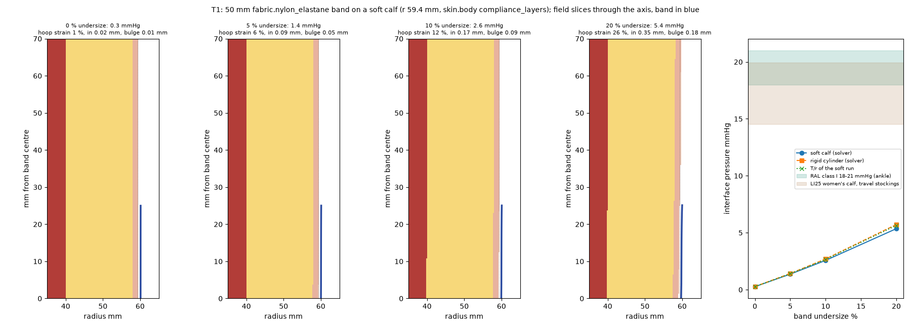

# Fabric under weights: balls resting and dropping on cloth, drape, and a band on a soft limb

Research record, 2026-11-07 to 2026-11-08. Licence CC BY 4.0 (text and the images listed here, all our own plots).

**Scope.** These are tests of the material library's fabric numbers and of the field-native contact solver, run on
synthetic scenes (a clamped square of cloth, a pedestal, a soft cylinder). They are not in Field Studio's window; cloth in
the tool is covered by the first release ([RESEARCH.md, Part 7, C2](../../RESEARCH.md)). The thresholds for every test were
written before its run (2026-11-07, about 22:25 PT), and the failures are kept as run.

Evidence states: *proposed*, *implemented*, *measured on named cases*, *reproduced under a frozen configuration*,
*accepted in the workflow*. Everything here is *measured on named cases*.

---

## 1. Where the fabric numbers come from

Each fabric profile carries Kawabata (KES) measurements: tensile stretch (EMT), shear (G) and bending (B) for warp and
weft, plus areal density and thickness. The solvers read them directly; nothing is tuned per test. The resulting
membrane stiffnesses span two orders of magnitude, from linen (16,344 / 12,258 N/m warp / weft) to a light
nylon/elastane sportswear knit (175 / 179 N/m). Leather has no measured tensile data in open sources; where it appears,
its value is marked as a default (E).

---

## 2. A ball resting in a hammock of cloth

**Setup (2026-11-08, 00:00-00:05 PT).** A 30 x 30 cm square of each fabric, clamped on all four edges, with a rigid 50 mm
steel ball of 100 g, 500 g and 2 kg resting in it. The cloth's stretch, shear, bending and weight come from its profile;
the ball touches the cloth only through the contact solver (a barrier on the distance between them), and the sag is
whatever the energy minimum gives. Solved on a quarter model with mirror symmetry, at two lattice spacings.

| Fabric | Sag at 100 g | 500 g | 2 kg | Exponent of sag in load |
|---|---|---|---|---|
| Linen | 13.1 mm | 21.8 mm | 33.8 mm | 0.315 |
| Polyester | 14.3 | 23.7 | 36.8 | 0.315 |
| Denim | 14.5 | 24.0 | 37.3 | 0.314 |
| Cotton | 14.7 | 24.3 | 37.6 | 0.313 |
| Leather (garment) | 14.9 | 24.5 | 38.3 | 0.315 |
| Wool | 15.1 | 24.8 | 38.5 | 0.313 |
| Silk | 16.1 | 26.7 | 41.5 | 0.316 |
| Nylon / elastane knit | 52.4 | 90.6 | 162.2 | 0.376 |

**What it measured.**

- **No crossing, converged, resolved.** Every gap stayed positive (the ball rests 0.08-0.10 mm off the cloth, the
  barrier's working distance); every state converged to a residual under 1e-7 of the load; a 1.5 times finer lattice
  moved every sag by 1.1-1.3 %.
- **The membrane law holds.** A pre-tension-free membrane under a point load sags as the cube root of the load
  (Foppl-type scaling). Every woven fabric, leather and silk gave an exponent of 0.313-0.316, against 1/3; the
  elastane knit gave 0.376, as expected for its J-shaped stretch curve. All inside the 1/3 plus or minus 15 % written
  before the run.
- **Stiffer cloth sags less.** The sag ordering follows tensile stiffness: Spearman rho -0.93 (p 0.0009) between sag and
  the geometric mean of warp and weft stiffness. The only swaps are among cotton, leather and wool, whose stiffnesses
  lie within 20 % of each other and whose weight and bending differ.
- **Cost:** 8-21 s per fabric for all three loads, 961-2,116 lattice nodes, on the CPU.

*Profiles through the centre of each clamped 30 x 30 cm sheet with the ball at 100 g, 500 g and 2 kg (dashed circles),
and the sag against the ball's weight on log axes (right): the wovens lie on parallel lines of slope close to 1/3; the
elastane knit sags three to four times further. Evidence: measured on named cases.*

### 2.1 The earlier cross-check, and the failure that shaped the cloth contact

An earlier bench (2026-11-07, 22:30-23:40 PT) ran the same hammock and a draped version (clamped on two opposite edges)
with a particle-lattice cloth whose contact was tested only at the cloth's own points. The wovens agreed with the later
solver (14-19, 22-31 and 35-49 mm at the three loads) and kept the stiffness order. But at 2 kg the elastane knit
stretched to about 500 % between points and **the ball passed through the gaps between them** (contact force zero).
Two causes were recorded: contact sampled only at points cannot hold a cloth that stretches that far, and the profile's
stiffening branch above the elastic limit (about 15 times stiffer) was not applied. Both became requirements for the
cloth contact: contact must be continuous over the cloth at any stretch, and the stretch curve must stiffen. The later
solver above meets the first on this scene (no crossing at 162 mm of sag).

The same bench's membrane solver was validated against Hencky's exact solution for a clamped circular membrane under
uniform pressure: 0.926 and 0.927 of Hencky's centre deflection at two spacings, within 7.4 % (the lattice's in-plane
Poisson ratio is not exactly Hencky's 0.3).

*The earlier cross-check: sag under a 50 mm ball for eight fabrics, clamped on four edges (left) and on two (right).
Leather uses a default stiffness (E). Evidence: measured on named cases; the knit at 2 kg failed non-penetration in this
bench.*

---

## 3. A ball dropped onto cloth

**Setup (2026-11-08, 00:09-00:28 PT).** A 500 g, 50 mm ball dropped from 10 cm (1.40 m/s at impact) onto each clamped
sheet; dynamic, implicit Euler with a 1 ms step, 5 mm lattice spacing.

| Fabric | Rebound coefficient e | Maximum sag | Ball leaves the cloth at |
|---|---|---|---|
| Cotton | 0.858 | 53.7 mm | 94 ms |
| Denim | 0.853 | 53.4 mm | 94 ms |
| Leather | 0.849 | 54.5 mm | 96 ms |
| Linen | 0.857 | 49.3 mm | 87 ms |
| Nylon / elastane | 0.800 | 179.7 mm | 276 ms |
| Polyester | 0.864 | 52.9 mm | 92 ms |
| Silk | 0.866 | 58.4 mm | 101 ms |
| Wool | 0.857 | 54.8 mm | 96 ms |

The pre-registered marks passed: no crossing at any step (minimum gap 0.078 mm), every step converged (residual at most
9.9e-8, shown in a second run at 02:07-02:40 PT), and e below 1 for every fabric, as a sphere on a tensioned membrane must
rebound. **What it does not show:** the fabric's own energy loss. The solver has no fabric hysteresis yet, so the
13-20 % lost here is the integrator's numerical damping plus energy left in the sheet's vibration, and the e values are
an upper bound. The profiles' measured loss per cycle (nylon/elastane 0.48-0.65) is not used yet, and their restitution
values (0.05-0.10) describe a different case, cloth dropped on a rigid floor. A gap, not tuned.

---

## 4. Cloth under its own weight: the Cusick drape test

**Setup (2026-11-07, about 22:25 PT, thresholds written first).** The standard Cusick test: a 30 cm circular specimen on an
18 cm pedestal, solved to static equilibrium by projected Newton from the KES numbers plus gravity, at two lattice
spacings. The drape coefficient (shadow area ratio) is compared with each fabric's measured class range.

| Fabric | Simulated | Measured range | Result (inside or within 0.10) |
|---|---|---|---|
| Cotton | 0.43 | 0.50-0.70 | pass, 0.07 under |
| Denim | 0.67 | 0.75-0.92 | pass, 0.08 under |
| Leather | 0.82 | 0.70-0.85 (garment) | pass |
| Linen | 0.59 | 0.60-0.80 | pass |
| Nylon / elastane | 0.16 | 0.25-0.40 | pass, 0.09 under |
| Polyester | 0.24 | 0.35-0.55 | **FAIL**, 0.11 under |
| Silk | 0.37 | 0.20-0.35 | pass |
| Wool | 0.39 | 0.45-0.65 | pass, 0.06 under |

Seven of eight pass, but most sit low, and the top views show why: there is **no self-contact** in this solver, so folds
pass through each other and into the pedestal's circle, which lets the cloth fall closer in. The two spacings differ by
0.6-4 points. A first version built on a position-based solver under-converged the bending: its answer depended on the
number of substeps (0.13 against 0.22 for the same cloth), so it was replaced.

*Each fabric draped over an 18 cm pedestal (side view as points, and top view with the pedestal in red and the flat
specimen in blue), with the simulated and measured drape coefficients and the bending length. No self-contact: folds may
pass through each other. Evidence: measured on named cases; polyester fails its mark.*

---

## 5. Fabric stretched around a soft limb

**Setup (2026-11-08, 00:00-00:40 PT).** A 50 mm band of the nylon/elastane knit closed around a soft cylinder the size of
an adult calf (radius 59.4 mm, from anthropometric survey data), with skin, fat and muscle layers from the library over a
rigid core, at 0, 5, 10 and 20 % undersize.

| Undersize | Hoop strain | Pressure | Tissue pressed in | Bulge beside the band |
|---|---|---|---|---|
| 0 % | 1.2 % | 0.26 mmHg | 0.017 mm | 0.009 mm |
| 5 % | 6.4 % | 1.37 mmHg | 0.088 mm | 0.046 mm |
| 10 % | 12.1 % | 2.57 mmHg | 0.167 mm | 0.087 mm |
| 20 % | 25.7 % | 5.36 mmHg | 0.351 mm | 0.183 mm |

- The pressure under the band's middle agreed with Laplace's law for a membrane (tension over radius) within 5.1 % at
  every undersize: the contact carries the band's load and nothing else.
- The tissue rose beside the band, and the displaced volume equalled the bulge plus the volume change to within 1 %
  (the tissue is nearly incompressible).
- A 1.5 times finer lattice moved every headline number by under 5.5 %.
- For scale: this light knit at 20 % undersize gives 5.4 mmHg, well under a class I compression stocking (18-21 mmHg at
  the ankle); real stockings are worn far more stretched.

*Sections through the axis of a soft cylinder (muscle red, fat yellow, skin pink) with the band in blue at 0, 5, 10 and
20 % undersize, and the interface pressure against undersize beside two published compression ranges (right).
Evidence: measured on named cases.*

---

## 6. Earlier, and outside the tool

On 2026-10-24, before the project's mesh-free rule (2026-11-07/08), a GPU solver built on tetrahedral elements dropped a 6.4 kg granite stone onto a
canvas held at four corners: the sheet sagged 16.4 cm and held the stone with no crossings. That solver used element
meshes and is not part of Field Studio; it is mentioned only because it was the first "weight on fabric" result in the
project.

## 7. What this file does not establish

- Cloth with weights in Field Studio's window.
- Fabric hysteresis (energy lost inside the fabric), so no measured rebound.
- Self-contact in the drape test.
- Any comparison with a measured ball-burst or ball-on-fabric force-displacement curve: none was found in open sources
  for these fabrics, so that mark makes no claim.
- Repeated runs: each number is one run on one machine.
