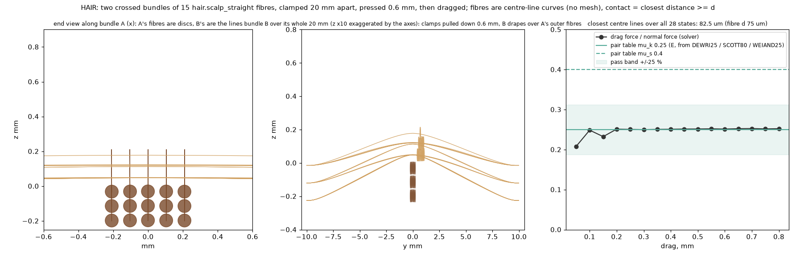
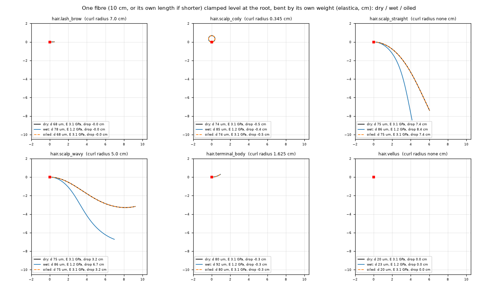
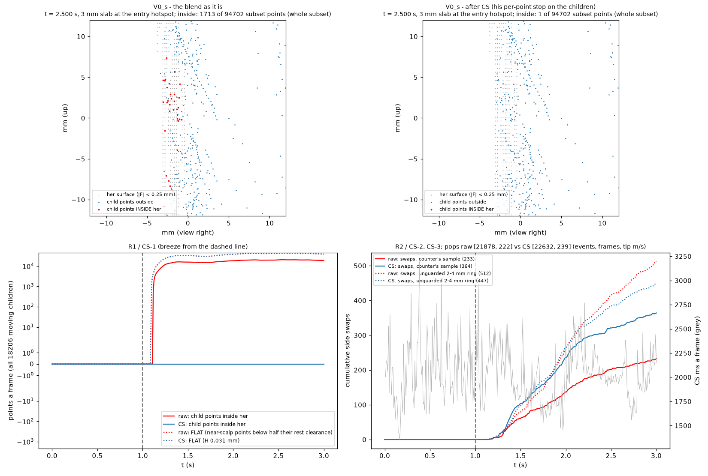
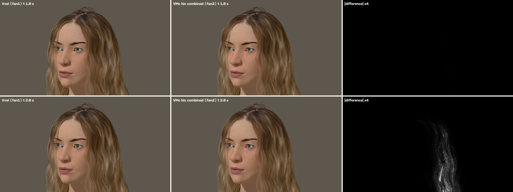
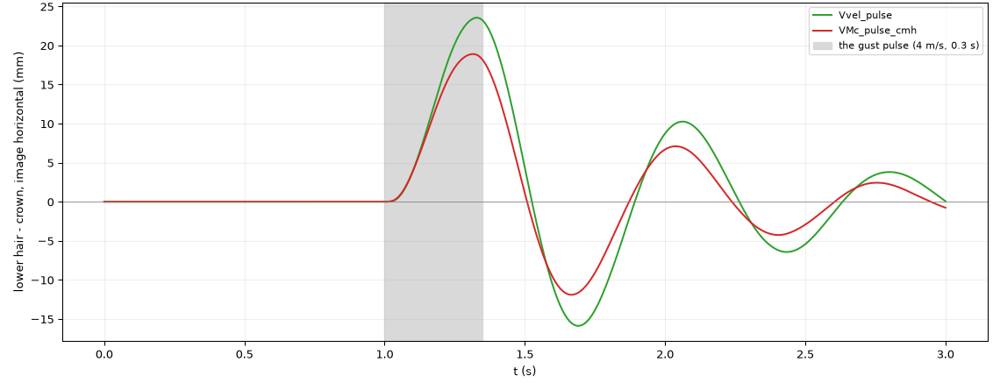
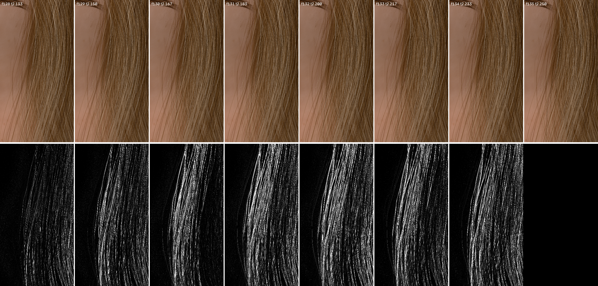

# Hair in motion: breeze, settling, contact with the skin, and two ways to compute it

Research record, mainly 2026-11-13 (PT), with earlier static checks from 2026-11-07. Licence CC BY 4.0 (text and the
images listed here, all our own plots and renders).

**Scope, stated plainly.** The first release published hair as statics: grown once, styled as states, settled to a rest
pose and rendered ([RESEARCH.md, Part 8, D1](../../RESEARCH.md)). Everything about hair *moving* is new here, and nearly all
of it happened on one day, on the CPU, mostly on a patch of 128 guide strands at the left temple of the human test model,
with one run over the whole head. **Nothing moves in Field Studio's window.** The planned 10-second head video with hair
motion and a blink was never rendered. At about 22:20 PT on 2026-11-13 the work was paused by decision: motion and video come
after the tool's baseline. So this record is thick for one day and thin overall.

Evidence states: *proposed*, *implemented*, *measured on named cases*, *reproduced under a frozen configuration*,
*accepted in the workflow*. Everything here is at most *measured on named cases*.

---

## 1. Two static checks that motion rests on (2026-11-07)

**Fibre on fibre.** Two crossed bundles of 15 straight scalp fibres each (75 um diameter, Young's modulus 3.1 GPa,
centre-line curves with no mesh), clamped 20 mm apart, pressed 0.6 mm together, then dragged 0.8 mm. The closest centre
lines over all 28 states were 82.5 um apart against the 75 um diameter: nothing passed through. Once sliding, the drag
over the normal force read 0.250-0.253 against the pair table's kinetic friction of 0.25, at two segment lengths.
Equilibrium was first reached in 26 of 28 states (two stick-slip states hit the iteration cap); with exact Hessians for
each distance type all 28 converged under 1e-6 (2026-11-08, about 09:00 PT). Cost: 171-775 s, quasi-static.
**Evidence: measured on named cases** (a synthetic scene; not dynamics).

*Two crossed bundles of 15 fibres: an end view (left), the upper bundle draped over the lower one along its 20 mm span
(centre, vertical axis exaggerated), and drag over normal force during the drag, flat at the pair table's 0.25 (right).
Evidence: measured on named cases.*

**Wet against dry.** One fibre clamped level at the root and bent by its own weight (the elastica), dry, wet and oiled,
from the profiles. A 10 cm straight scalp fibre drops 7.4 cm dry and 8.4 cm wet: wet keratin's modulus falls from 3.1 to
1.2 GPa and the fibre swells to 86 um. Oiled is mechanically the same as dry (oil changes only the surface); a coily fibre
holds its coil. A check of direction against measured fibre properties, static only.

*Six hair kinds, each a single fibre clamped level at the root, dry (black), wet (blue) and oiled (orange, dashed).
Evidence: implemented; computed from the profiles.*

---

## 2. A first dynamics prototype (2026-11-13, 00:39-01:20 PT)

60 guide strands of 64 nodes each, at 60 frames a second with 12 substeps: each guide solved implicitly (backward Euler)
with inextensibility rows, the skin as an inequality, Coulomb friction 0.5, a density pressure between strands, and a
hold force that makes the styled groom an exact equilibrium.

- In still air the hair stayed put: drift at the 95th percentile 0.30 um (maximum 2.4 um) over 0.5 s.
- In a 0.8 m/s draft the tips moved up to 23.3 mm (median 2.8 mm).
- 188 ms a frame on 2 threads.

Four earlier versions failed, each measured: a least-squares tension buckled a guide 70 mm in 0.3 s; a carried rest frame
that lagged one step fluttered (growing with a 27 ms time constant); a pressure held fixed drifted 34 mm in 0.5 s; friction
applied after the solve stretched tip segments by 0.93 mm.

**Patent note** (engineering reading, not legal advice): this prototype's velocity update from positions was flagged in
our review against position-based dynamics patents (US 7,616,204; US 11,270,041). It is a research prototype and is not
in the code.

---

## 3. The hard stop on hair, and where hair really enters the skin (13:53-17:24 PT)

**Setup.** 128 guides at the temple carrying 18,206 moving child strands (the strands actually drawn, each following
its guides). One second of still air, then two seconds of breeze (0.8 m/s, gusting to 1.12 m/s), at 120 frames a second
with 6 substeps.

| Variant | What it adds | Cost a frame | What it showed |
|---|---|---|---|
| V0 | plain dynamics | 244 ms (2 threads) | tips up to 25.5 mm (median 5.1 mm); 233 strand side swaps; up to 20,453 child points inside the skin in a frame |
| VA | the hard stop between guides (pair rows) | 3.4 s | held in still air (-0.6 nm) but broke in the breeze: gaps to -188 um and nodes 374 um into the skin, because the skin's active set was frozen during the pair solve |
| VQ | quasi-static | 0.80 s | only 4 swaps beyond the blend, but under-converged |
| VL | a per-point local rule | | 6.8 times the crossings; tips to 0.61 m/s |

A density ceiling of 0.95 never came into play (the highest measured density was 0.095).

**The key finding:** the crossings and the skin entries come from the **child strands' displacement blend**, not from
the guides: 95 % of them are beyond what a rigid motion of the same guides would give. So the fix belongs to how
children follow guides, not to the guide solver.

**A stop on the children** (CS-a) puts every child point back outside the skin's field: **0 child points inside on every
frame**, against 3,947 a frame under the fan and 103,000-113,000 a frame over the whole head without it. It costs 2.0 s a
frame on 4 threads on the patch, and 6-8 s a frame with 4.1 GB over the whole head. Two guards against strands crossing
each other failed (one went from 745 to 811 crossings; another from 233 to 5,494, with strands stretched up to 57
times). A lesson about the field: the stored distance band is clamped at plus or minus 3 mm, and stepping along its
gradient in the clamped zone flung one test point 68 km in a smoke run.

*Top: a 3 mm slab at the worst spot, child points as blended (left: 1,713 of 94,702 inside, red) and after the
per-point stop (right: 1 inside). Bottom left: child points inside per frame over the breeze, raw against stopped.
Bottom right: cumulative strand side swaps, and the stop's cost a frame (grey). Evidence: measured on named cases.*

**Children by guide key** (a later measurement). Instead of blending displacements, each child takes a key to its guides.
Over 17,915 strands: blending gave 106 crossings, a key to one guide 529 (all at seams between guides), a key to four
guides 84. Under a rigid turn the key is exact to 0.04 um where the blend is off by up to 2.2 mm. Tip wobble at 120 frames
a second was about one pixel at the 99th percentile in a 1080p head view. The card ran out of memory beside the renderer,
so children were blended on the CPU at about 7 s a frame.

A modal method alone was rejected the same afternoon: without contact in its modes, 73,215 child points ended up inside.

---

## 4. The combined method (16:41-18:17 PT)

Twelve vibration modes per guide, with contact impulses and friction applied inside the modes, resting nodes held, and
keratin's damping.

| | Full dynamics | Combined method |
|---|---|---|
| Temple patch, ms a frame (threads) | 256 (4) | 16-20 (2) |
| Loose locks' tips, median / 90th pct / max | 3.7 / 10.9 / 20.6 mm | 3.7 / 10.5 / 20.0 mm |
| Whole head (1,023 guides, fan), ms a frame (threads) | 1,122 (4) | 113 (2) |
| Whole head tips at the peak, max / median | 42.8 / 4.25 mm | 45.7 / 3.15 mm |
| Drift in still air | 0.14 um | 0.045 um |

The speed claim was corrected on a second reading: about 10 times faster in wall time and about 20 times in thread-seconds,
and **not identical motion**. One defect is measured: tail jitter at the 99th percentile of 0.35 mm against 0.24 mm,
because the full dynamics' backward-Euler step adds numerical damping (damping ratios 0.04, 0.09 and 0.23 at 10, 20 and
60 Hz) that the modes do not have. With 48 modes instead of 12 it blew up (220 mm, 12 m/s). **Evidence: measured on named
cases; not accepted.**

*The human test model's head under the oscillating fan at 1.0 s and 2.0 s: full dynamics (left), the combined method
(centre) and their difference times four (right). The face is visible. Evidence: measured on named cases.*

---

## 5. The breeze, and how hair settles

**The first breeze was wrong.** It blew from the camera's side and pressed the hair onto the head: only 5 % of the
camera-facing hair moved 5 mm or more. It was replaced by an oscillating fan 1.75 m to the front-right, sweeping plus or
minus 35 degrees with a 12 s period (a setting, not sourced), 1.0 m/s at the head with 25 % turbulence, the head treated
as a sphere in potential flow. Now 28 % of the camera-facing hair moved 5 mm or more (90th percentile 8.7 mm, maximum
18.9 mm), and child entries into the skin fell four times. **Open:** between fan passes the air goes nearly dead (under
0.01 m/s for 2-3 s), so the hair decays almost to rest; a background room flow was proposed and not run.

Our hair's speeds under the fan had medians of 4.9 mm/s (full dynamics) and 5.3 mm/s (combined method). They were also
compared with hair in a gentle breeze measured from stock-video previews; those previews were used for study only, so
their numbers are not reproduced here.

**Settling after a gust** (a 4 m/s pulse for 0.3 s). The hair swings with a period of about 0.74 s and overshoots by a
ratio of about 0.6 each half-swing, for four or five half-swings: a damping ratio near 0.15. Published laboratory
measurements put hanging tresses at damping ratios of about 0.15-0.23 when clean and straight and 0.23-0.29 for ponytails
(Bechthold et al. 2018, J. Cosmet. Sci. 69; Evans and Breugnot 2018), so ours sits at the low edge: hair settles a little
too slowly. Hair-on-hair friction as the missing damping is a hypothesis, not tested.

*Lower hair relative to the crown, horizontal in the image, after a 4 m/s, 0.3 s gust (grey band): full dynamics (green)
and the combined method (red). Evidence: measured on named cases.*

---

## 6. Rendered motion

The fan runs were rendered at 960 x 540 with 16 passes, 27-31 s a frame (28.8 s of it the hair). Strands moved up to
15.7 mm, but that is hard to see in stills. A close clip of the temple (37 frames at 60 frames a second, about 22 s a
frame) was judged on review to show essentially nothing: the mark for a proof of hair motion is that the hair
can genuinely be seen to move. The whole-head clip was never queued, and at the measured costs the full 10-second video
at 120 frames a second was estimated at 8.6 hours, against a 1-hour target.

The blink planned for the same video passed its geometry on the CPU (no lid point inside the eye over 138 states; 11.1 mm
of travel, peaking at 274 mm/s), but frames with a moving lid reset the graphics driver on the card, and a tear bound to
the lid was found. The blink was not rendered.

*Eight consecutive frames (60 frames a second) of rendered hair at the human test model's temple (top), and the
frame-to-frame difference times six (bottom): the motion is real but small. Evidence: measured on named cases; on
review the clip did not show visible motion.*

---

## 7. Earlier, and archived

Before the mesh-free rule, an in-browser hair studio (2026-11-01) ran 1,005 guides at 7.7-12 ms a frame on the card and
measured a brush, a comb, a hand and a fan (for example, a 12 m/s dryer for 1 s moved 9,801 points more than 5 mm).
Its body was a mesh, so it was archived on 2026-11-08, and its stand-ins (a speed cap, a chosen air
drag) were judged to make superficial demos. It is not part of Field Studio.

## 8. What this file does not establish

- Hair moving in Field Studio's window, at any frame rate.
- Hair responding to head motion: not tested (the rest frame is not yet invariant to rotation).
- A hand through hair, or brushing in motion (only in the archived studio), or wet hair dynamics.
- A rendered video in which the motion is clearly visible.
- Damping matched to measurement: ours rings slightly longer than the laboratory range.
