# Materials: the library rendered, and the measurements behind it

Research record, 2026-11-07 to 2026-11-14. Licence CC BY 4.0 (text and the images listed here, which are Field Studio's
own renders and plots unless a caption says otherwise).

The first release described the material library's schema and the plan for proof sheets
([RESEARCH.md, Part 3, section 2.9](../../RESEARCH.md)). This file covers what was built and measured since: six stones and
brick that now carry their structure in the field and their measured colour in the renderer, the colour work that got
them there, the states a material can be in (weathered, soiled, rained on), and the older bench checks of the library's
physical numbers. The status review gives the short version ([STATUS_2026-11-14.md, sections 2.6 and 4.4](../../STATUS_2026-11-14.md)).

Evidence states used throughout: *proposed*, *implemented*, *measured on named cases*, *reproduced under a frozen
configuration*, *accepted in the workflow*. Nothing in this file has reached the last two.

---

## 1. What "a material" means in the tool

A material is a profile (one JSON file) plus a seeded generator. The profile holds the physical numbers, each with a
quality letter: **M** measured in the cited source, **D** derived here from measured data, **E** estimated, with the
reason. The generator builds the material's structure in two places:

- **In the field** (the stored signed distance): relief, edge chips, crumbled arrises, cracks with real depth. These are
  geometry. A section through a cracked brick shows the crack as a cavity; a chip removes material.
- **In the renderer's optical medium**: a volumetric composition field (grains with their own hues, clear quartz,
  the spaces between grains, laminae, iron staining, crystals by mineral) whose mean is held to the measured colour at
  every zoom, plus grain-scale relief marched at render time with its own sun shadow and sky occlusion.

Assigning a material to an object makes it that material: its weight follows from its density and volume, its colour
from its measured spectrum, and its structure from its seed. Five copies made with Array and Vary are five different
bricks of the same stone.

| Family | Profiles | Look in the tool | Physical numbers |
|---|---|---|---|
| Stone | sandstone, limestone, granite, marble, slate | yes (structure + measured colour) | density, friction by finish, roughness by finish, measured colour |
| Brick & clay | fired clay brick | yes | density 1,636 kg/m3 (M), water absorption 14 % (M) |
| Wood | oak, pine, maple, walnut | not yet | orthotropic stiffness, density (pine 571 kg/m3), contact angles |
| Glass | soda-lime, borosilicate, fused silica, lead crystal | not yet | refractive index, density, measured water contact angles |
| Metal | steel, aluminium | not yet | density, friction, restitution |
| Fabric | cotton, wool, silk, linen, denim, polyester, nylon/elastane, leather (and two knits) | not yet in the tool; bench renders exist | KES stretch, shear and bending; regain; drape class |

So, as to what each material can do: **the six masonry materials are built, measured and rendered in
the tool**; wood, glass, metal and fabric exist as measured profiles used by the solvers and the bench renderers (the
fabric, water and droplet results below and in the other files), but have no generator in the tool yet.

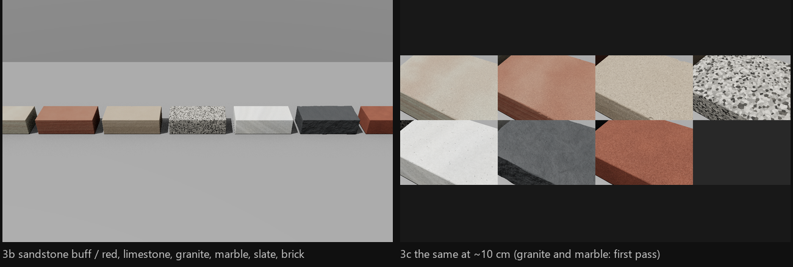

*The masonry library as first rendered in the tool on 2026-11-14 (about 03:30 PT): sandstone buff and red, limestone,
granite, marble, slate, brick, each a measured colour. Granite and marble were a first pass here; granite was rebuilt
later (section 5). Evidence: implemented; measured on named cases.*

---

## 2. Colour: measured spectra in, and a pipeline traced end to end

**Sources.** About 95 reflectance spectra from two public libraries: 88 from the ECOSTRESS Spectral Library v1.0
(JPL; cited as Meerdink et al. 2019 and Baldridge et al. 2009; the numbers are used as facts with citation, the raw files
are not redistributed) and 7 from the USGS Spectral Library v7 (Kokaly et al. 2017, US public domain). Each spectrum was
resampled to 1 nm over 380-780 nm, integrated against the CIE 1931 2-degree observer under D65, and taken to linear sRGB
with the IEC 61966-2-1 matrix, white-normalised so a perfect reflector is (1, 1, 1). A cross-check against an
independent colour library agreed to 1e-4.

**Form matters.** The same rock measured as a fine powder (0-75 um) reads 1.4-2 times lighter than its solid face,
because many small grain boundaries raise multiple scattering. A block takes the *face* value.

| Material (faces) | n | Luminance Y, mean (range) | Linear RGB mean | Note |
|---|---|---|---|---|
| Sandstone, all colours | 7 | 0.217 (0.110-0.424) | 0.261, 0.209, 0.166 | three families: buff-grey, red-brown (haematite step above 550 nm), grey-green |
| Fired red clay brick | 6 | 0.109 (0.089-0.149) | 0.208, 0.085, 0.058 | darker and more saturated than common texture-library guesses (R/G 2-3) |
| Limestone, light building types | 7 | 0.541 (0.370-0.640) | 0.565, 0.538, 0.494 | the full set (17) runs white to black |
| Granite, grey to pinkish | 8 | 0.244 (0.169-0.357) | 0.264, 0.241, 0.213 | |
| White marble | 2 | 0.765 (0.742-0.788) | 0.790, 0.765, 0.683 | |
| Grey slate | 2 | 0.134 (0.095-0.172) | 0.138, 0.133, 0.129 | |

**The finding: the render was right; the sample was grey.** The first sandstone read greyer than the building stones
people picture. Before changing anything, the colour pipeline was traced end to end (2026-11-14, about 03:30-04:10 PT):
the rendered top face, taken back through the display encoding and the inverse of the tone curve, gave the measured
chromaticity of the source sample (R/G 1.07 against 1.08, G/B 1.21 against 1.22; scene-linear 0.439, 0.410, 0.339
against 0.457, 0.422, 0.345). The renderer carried the colour intact. The cause was the sample: Berea sandstone (a light
grey-buff stone, hue 93 degrees, chroma 8.6). Warm building sandstones were not in the spectral libraries at all.

**The fix at the cause: measured warm varieties.** Published CIELAB measurements of building sandstones (d/8
integrating-sphere instruments, D65), all from open-access papers under CC BY 4.0, were converted to linear albedo:

| Variety in the tool | Stone (source) | L*, a*, b* | Linear RGB | R/G, G/B |
|---|---|---|---|---|
| cream_buff (default) | Demanda Gold, Burgos (Gomez-Marfil and Varas-Muriel 2023, Materiales de Construccion 73(349)) | 71.5, 3.5, 13.2 | 0.522, 0.413, 0.311 | 1.26, 1.33 |
| buff | Woodkirk, Leeds (Carmona-Quiroga et al. 2017, PLoS ONE 12(2)) | 61.8, 2.4, 15.3 | 0.372, 0.291, 0.197 | 1.27, 1.48 |
| golden | Alcaniz, Teruel (Lapuente Mercadal et al. 2024, Heritage 7(2)) | 68.9, 4.0, 17.0 | 0.498, 0.375, 0.253 | 1.33, 1.48 |
| deep_golden | Uncastillo, Zaragoza (same) | 63.0, 4.1, 16.1 | 0.405, 0.301, 0.202 | 1.35, 1.49 |
| grey_buff | Berea face (ECOSTRESS) | 71.2, -0.4, 8.6 | 0.457, 0.422, 0.345 | 1.08, 1.22 |

The warm stones differ from Berea mainly in a* and chroma (C* 12-17.5 against 8.6), not in lightness. Each variety also
carries its own colouring mineral for the staining described below (goethite for buff and golden, haematite for red and
brown), after a first version pushed every variety pink along a single red axis.

Two further checks, both measured: the darker, browner look of side faces was **light and the display curve's toe, not
albedo** (a flat patch of the same variety turned to face the key light rendered the top's colour); and the conversion's
uncertainty from the 10-degree to 2-degree observer change moves R/G and G/B by at most 0.031, small next to the
differences between stones.

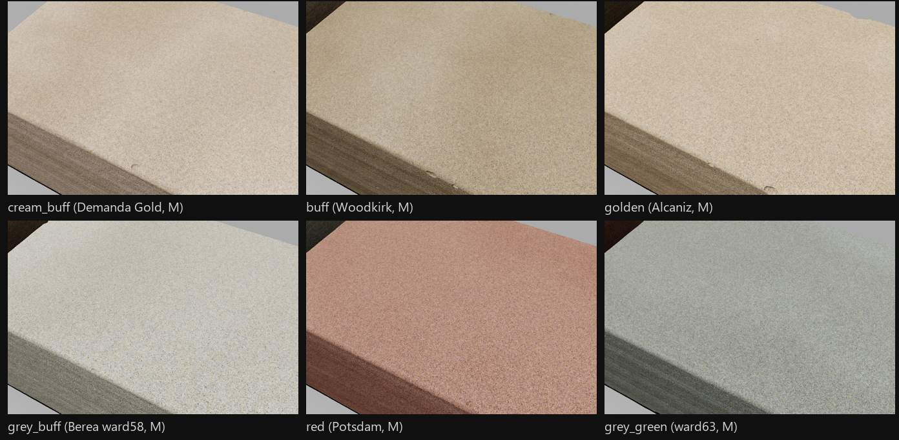

*Six sandstone varieties at 10 cm, each from a published colour measurement: cream_buff, buff and golden (top), Berea
grey_buff, red and grey-green (bottom). Evidence: measured on named cases (one scripted run, the real window's renderer).*

**Open.** No measured weathered colour exists for these stones in open sources; no buff fired brick spectrum was found;
no free, verified BRDF fit for stone exists that we could use (the one large measured set has no stone and is
non-commercial).

---

## 3. Structure built in the field

### 3.1 Iron staining in the volume

Patches and Liesegang-type bands (the concentric rings iron oxides leave as they precipitate) are built as level sets of
a patch field in the stone's volume, so a cut or a chip shows the same staining inside. The first version drew the rings
as thin contour lines; they are now graded fronts behind each patch edge, as in reference specimens.

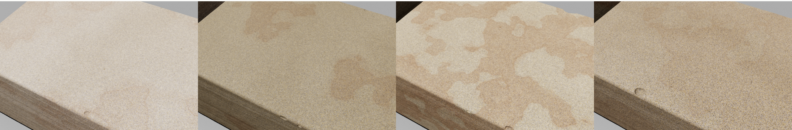

*Iron-stain patches with graded ring fronts, in four varieties. Evidence: implemented; measured on named cases.*

### 3.2 Laminae, and a periodic artefact traced to its cause

Sandstone laminae (the fine bedding layers) first produced a faint plaid on tooled faces. Measured cause: the laminae read
gradient noise along a line that passed through lattice points, where such noise is zero by construction, so the bands
repeated at the lattice spacing. Reading the noise on an oblique line removed it: the row-band standard deviation fell
from 2.08 to 0.33 (the laminae alone switched off gave the same 0.33).

**Bedding** is now a setting (natural, face-bedded, edge-bedded) that turns the laminae's plane relative to the block.
Under raking light a face-bedded droved block measured a row standard deviation of 0.34 against 3.03 for natural bedding;
the faint horizontal bands in the natural case were the laminae, not the tool marks.

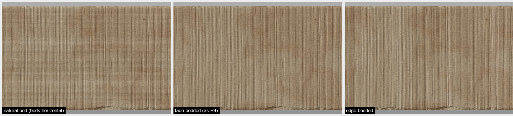

*A droved (claw-chiselled) sandstone face under raking light in three bedding orientations. The reference column of the
original sheet is cropped out. Evidence: measured on named cases.*

### 3.3 Tool finishes

Finishes carry their own relief amplitude. Measured roughness values taken as inputs (published, used as facts): polished
granite Ra 0.3-0.6 um, honed 3.5-5.3 um, sawn 21.8-25.4 um, flamed above 500 um (Sanmartin, Silva and Prieto 2011);
Carrara marble polished 0.3 um, disc-sawn 2.9 um, heavy bush-hammered 26.5 um (Careddu and Aru 2023). With polished faces
at 60-90 gloss units and honed, sawn and split faces at 2-25, every finish but polished is dominated by diffuse
reflection, and its specular response comes from the grains rather than from one roughness number.

The droved (tooled) sandstone finish is chisel strokes about 3.5 mm apart in two passes, each groove scalloped and of its
own depth (amplitude 0.10 mm), each groove with its own blows along its length (blow length 10 mm). This is geometry, not
a texture: card and CPU agree to 8e-8 m.

**Open, and what was tried.** At the reference photograph's own scale (about 0.05 mm a pixel), real droved stone shows
soft, clustered lumps of 0.5-1.5 mm with broad grooves; ours shows a fine 0.2 mm speckle. More grain relief only added
speckle. Crushed facets at 0.8-1 mm cast thin black shadows that read as cracks. Neither was kept. Rounded domes at the
lump scale are the next candidate.

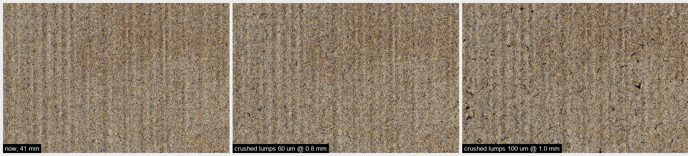

*The droved face at a 41 mm field: as built (left), and two crushed-lump variants that were not kept because their
facets cast crack-like shadows. Evidence: measured on named cases; the gap to the reference is open.*

### 3.4 Chips on the arris, and the brick's fired skin

Edge chips were first measured to be wrong: their axes sat a median 31 degrees off the bisector of the two faces and 56 %
lay on one face only, so they read as round pits. Cause: the edge detector flagged face points near the arris and each
chip took that point's face normal. Each chip is now snapped onto the arris itself (median 11 degrees, 2 % one-sided),
is a cluster of 1-4 near-flat facets, 4-20 mm long (sizes read from photographs of chipped bricks; an estimate, no
published distribution was found), elongated along the edge.

A continuous **crumble** runs along every arris: a tube-shaped cavity whose radius follows thresholded noise, covering
76 % of the arris length, bites a median 0.40 mm deep (90th percentile 1.0 mm, maximum 1.35 mm), now with two octaves.
Card and CPU agree to 8.2e-8 m. Its cost is real: it widens the band of stored bricks around the object, which sets the
card memory per chipped object, so its amplitude is kept small.

Fired brick has a **skin**: the face is the fired, measured colour; 0.6 mm below it the body is paler and more orange,
so a chip shows the body. The body colour is an estimate (E); a lit photograph of a broken brick with face and fracture
together is still wanted.

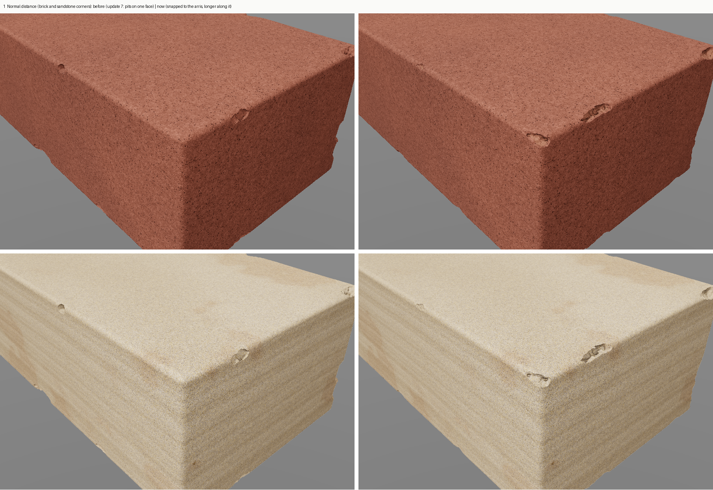

*Before (left): chips as pits on one face. After (right): chips snapped to the arris and elongated along it, on brick
(top) and sandstone (bottom). Evidence: measured on named cases.*

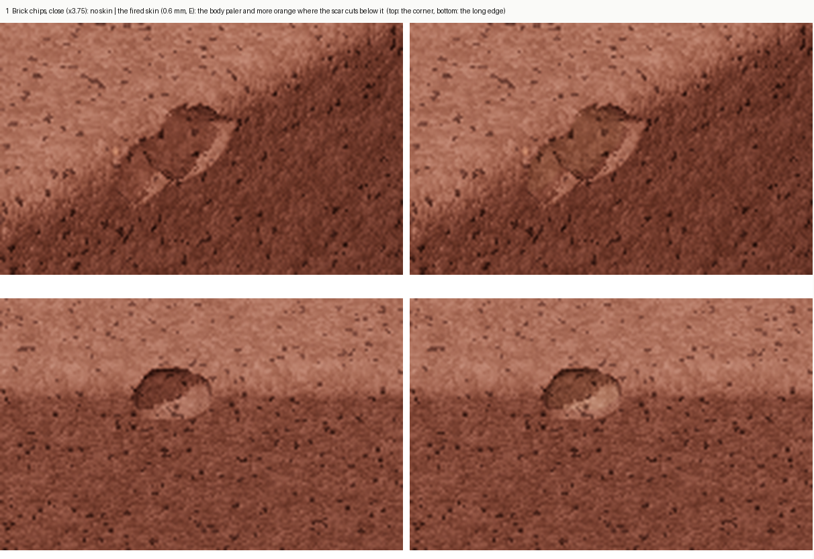

*A chip close up, without (left) and with (right) the fired skin: the scar shows the paler body. Evidence: implemented;
the body colour is an estimate.*

---

## 4. States: weathering, deposits, rain

A material can be in a state, set from 0 to 100 % and carried by every copy.

**Weathering.** For brick the colour shift is measured: the ECOSTRESS pair of a weathered and a bare red brick of the
same kind differ by (-0.03, -0.08, -0.15) in log RGB. Weathering also wears the arrises round (to about 6 mm radius at
100 %; the reference bricks measured 3-5 mm, so ours is not too little) and raises the micro-relief. For sandstone no
measured colour pair exists, so only the wear and the grains change.

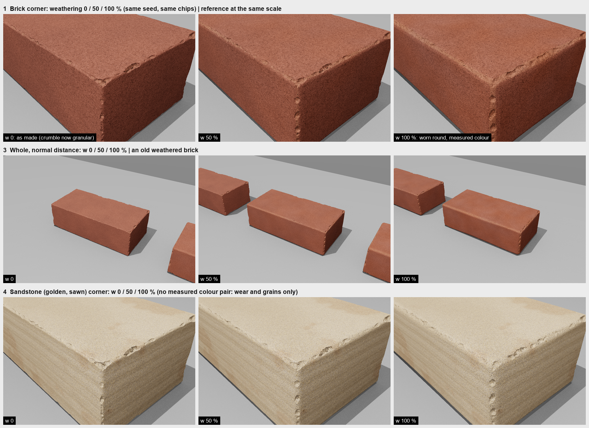

*Weathering at 0, 50 and 100 %, same seed: brick corner, whole bricks, and a golden sandstone corner. The reference column
and a row of reference crops are removed from the original sheet. Evidence: measured on named cases (the brick colour
shift is measured; the arris radius was compared with a reference).*

**Deposits.** Dust, lime (efflorescence) and soot as a film that fills hollows first, biased toward upward faces, in
patches, and cleared from the arrises. Their colours are estimates (E); measured spectra of real soiling are an open ask.
**Exposure** (sheltered, part exposed, in the rain) decides where the deposit stays: rain washes tops and sides and
leaves soft run-off streaks below, with splash at the base. Run-off starts where the form says water collects: from the
crumbled top arris and from the scars of the larger chips, drifts along the face and branches.

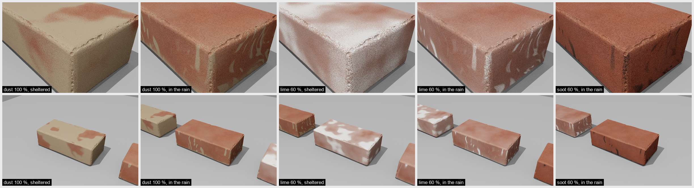

*Dust, lime and soot deposits on a weathered brick, sheltered and in the rain. Evidence: implemented; deposit colours are
estimates.*

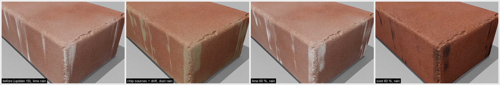

*Run-off streaks that start at the top arris's chip scars (second to fourth) against the earlier version (first).
Evidence: implemented; not compared with a measurement.*

---

## 5. Granite: crystals by mineral

The first granite read as terrazzo: flat cells of one size. It is now built as crystals by mineral, each with its own
share, size spread and optics: quartz grey and glassy, feldspar white or pink and milky with cleavage glints, biotite as
black plates with frayed outlines, each crystal zoned from core to rim (plus or minus 0.3 in log albedo) with darker
boundary seams. The mean colour stays the measured one (to 0.04 % on the CPU check).

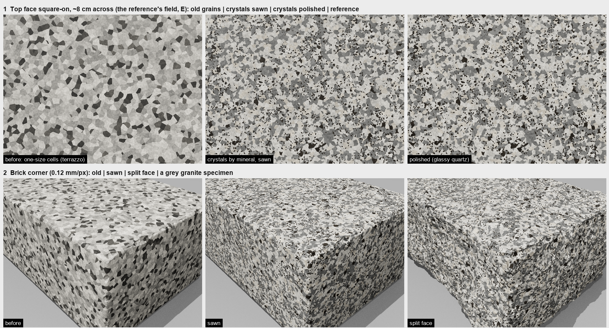

*Top: the old one-size cells, crystals by mineral sawn, and polished. Bottom: a corner, old, sawn and split face. The
reference column is cropped out. Evidence: measured on named cases.*

**Open.** Beside a polished Barre granite photograph the result still reads flatter and more camouflage-like than the
real stone at 25 mm: real quartz and feldspar show depth because light enters them. That needs a subsurface term in the
renderer, which does not exist yet. A design is proposed (below), not built.

---

## 6. Light that enters the stone (proposed)

Marble, and the glassy quartz in granite, need light to enter the material. The proposal (2026-11-14, about 07:10 PT) is
a bounded random walk inside the field: refract in at the surface (Fresnel at calcite's n = 1.486), walk by sampled free
flights, scatter by a Henyey-Greenstein phase function, estimate the sun at each vertex, stop when the field says
outside. The surface albedo is scaled so that a thick, flat, sunlit patch keeps its measured mean (the face spectrum
already includes its subsurface light). The checks declared before any build: a thick sunlit patch within 2 % of
today's mean; a 5 mm back-lit slab glows and a 50 mm block does not; every frame without the medium bit-identical.
Diffusion-profile methods were avoided on purpose because of their dense patent history; a claim reading of the
random-walk route is required before it lands. **Evidence: proposed.**

---

## 7. The library's physical numbers, checked on the bench (2026-11-07 and 11-08)

Before any of this reached the tool, the profiles' own numbers were checked against simple, known physics.

- **Touch temperature.** Skin at 33 C touching each material at 20 C, from the two effusivities: stone 24.1-24.8 C,
  glass 25.7-26.3 C, wood 29.3-29.9 C, fabrics 31.1-32.0 C. Stone feels cold and wood and cloth warm, as they do (a
  check of order, D).
- **Bounce.** Rebound height from a 1 m drop onto a rigid flat for the 21 materials with a restitution value; glass the
  highest, soils the lowest.
- **Fabric moisture.** Moisture regain at 65 % RH and 20 C against the standard values: 4 of 8 failed at first because
  the profiles carried the wrong variant (mercerised cotton, raw flax); corrected to the cited values, 8 of 8 within
  1 point. The drying order (polyester before cotton) matched; the wet-stiffness direction matched for 6 of 6 once wet
  strength was added.
- **Denim colour.** The first indigo was an estimate and came out a saturated royal blue. It was replaced by the measured
  on-fibre absorption shape (peak 660 nm; Peruzzi 2021, CC BY), with the strength bracketed to measured denim
  reflectance (light wash Y 0.108, raw Y 0.034).

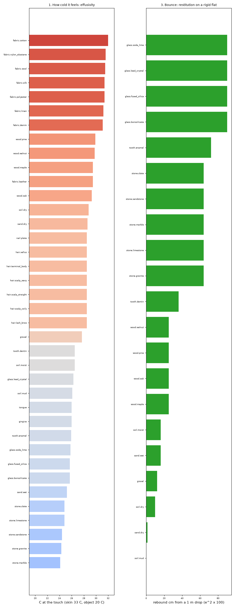

*Left: the temperature at the touch, skin 33 C against each material at 20 C. Right: rebound from a 1 m drop onto a rigid
flat. Panels 1 and 3 of a three-panel sheet, joined; the middle panel is omitted. Evidence: measured on named cases
(computed from the profiles; order checks).*

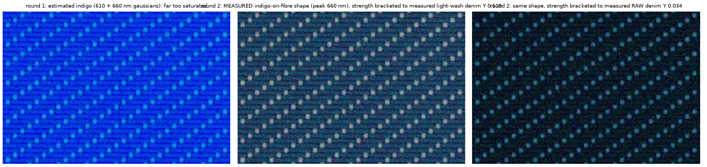

*Denim on the fabric bench: the estimated indigo (left), and the measured on-fibre absorption shape bracketed to measured
light-wash and raw denim (centre, right). The reference scan in the original sheet is cropped out. Evidence: measured on
named cases.*

---

## 8. Patents read for the material look

Engineering readings by non-lawyers, not legal advice; the full table is in [PATENTS.md](../../PATENTS.md).

- **Adobe US 8,379,021 B1** (shadows on height fields). Our grain shadow tests the light ray's clearance against the
  relief at six fixed distances and reduces those clearances to a visibility; it never searches for the surface point
  at the greatest elevation angle. The readers marked one claim for a closer read.
- **Pixar US 7,672,476** (band-limited noise). The look uses gradient noise and cellular noise, not wavelet noise.
- Several other relief and displacement patents were read and found to rest on polygons, displacement maps, horizon maps
  or depth buffers, none of which the field renderer has.

## 9. What this file does not establish

- That any material passes the tier ladder: by its own rule a tier passes when it is run live by hand, which has not
  happened.
- Any repeated timing or colour measurement: each number above is one scripted run on one machine.
- A wood, glass, metal or fabric look in the tool.
- That the stone looks match their references: a side-by-side comparison still finds them cooler and flatter than the
  photographs, granite flatter than real, and close-up chip bites too smooth.
