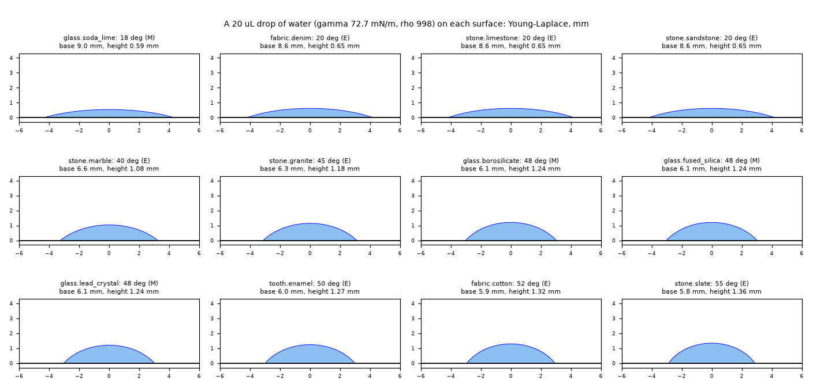
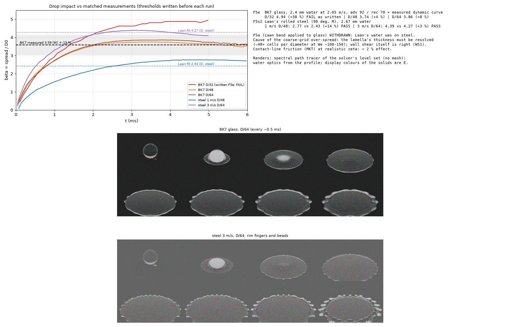
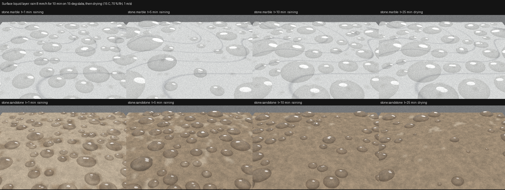
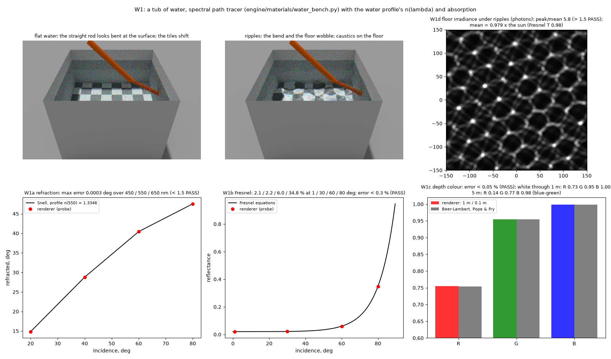

# Rain and water drops on glass and stone

Research record, 2026-11-07 to 2026-11-09. Licence CC BY 4.0 (text and the images listed here, all our own plots and
renders).

**Scope, stated plainly.** There is no rain in Field Studio's window yet; rain and water are later rungs of the tool's
acceptance ladder. What exists is measured work in two separate engines that the tool will call: a *surface liquid
layer* (drops, films and wet states carried as points on any field's surface) and a *3-D water solver* (particles on a
grid with a level-set surface). Both are mesh-free. This file records what they showed about drops on glass and stone:
where a drop sits, how it beads, when it slides, how it spreads on impact, and what rain does to a tilted slab. It also
records the failures, because several of them changed what we believe about the published numbers.

Evidence states: *proposed*, *implemented*, *measured on named cases*, *reproduced under a frozen configuration*,
*accepted in the workflow*. Everything here is at most *measured on named cases*, mostly on one machine, one run each.

---

## 1. Where a drop sits and what shape it takes

A resting drop's shape is set by the liquid's surface tension and density and by the surface's contact angle. The library
holds the angles per surface in pair tables, each with its source and quality letter. The rest shape of a 20 uL water
drop was solved from the Young-Laplace equation to the drop's volume for 30 surfaces (2026-11-07).

| Surface | Static angle | Footprint, height (20 uL) |
|---|---|---|
| Clean soda-lime glass | 18 deg (M) | 9.0 mm wide, 0.59 mm high: gravity flattens it |
| Borosilicate, fused silica, lead crystal | 48 deg (M) | 6.1 mm, 1.24 mm |
| Marble | 40 deg (E) | 6.6 mm, 1.08 mm |
| Granite | 45 deg (E) | 6.3 mm, 1.18 mm |
| Slate | 55 deg (E) | 5.8 mm, 1.36 mm |
| Hair fibres | 82 deg (M) | 4.7 mm, 1.83 mm: a bead |

Glass is not one surface. The same borosilicate measured "in use" (aged, not cleaned) has advancing and receding angles of
36.1 and 11.6 degrees (M), and an uncleaned optical glass (N-BK7) 92 and 70 degrees (Quetzeri-Santiago et al. 2019,
Scientific Reports, CC BY 4.0). Which glass is in a scene changes the result more than any solver setting did (section 3).

*A 20 uL water drop at rest on twelve library surfaces, solved from the Young-Laplace equation (first three rows of a
30-surface sheet). Evidence: implemented; the shapes follow from the angles, which are measured (M) for the glasses and
estimated (E) for most stones.*

---

## 2. Pinning, sliding and running

**The law.** A drop on a tilted surface stays pinned while the contact-line retention force exceeds its weight's
component along the slope. Retention follows Furmidge's form F = k gamma w (cos theta_R - cos theta_A), with the factor
k from ElSherbini and Jacobi (2006); the gap between the advancing and receding angles (hysteresis) is what pins a drop.

**What the first check found (2026-11-08, about 18:06-18:15 PT).** The first sliding test compared the layer against
sliding angles stored for glass, and failed. Reading the source afterwards showed that those stored angles were
themselves derived from the same law (D, not M), so the test compared the law with itself. The run also exposed a real
bug: the retention force was doubled (the factor was applied to the drop's width instead of its radius). Both are
recorded as run; neither was re-judged.

**The matched test, passed.** Against a measured case (water on PMMA, 60 uL, Ma et al. 2022, the paper's own angles), the
layer's onset tilt was 20.5 degrees against the measured 24.1 (-15 %, inside the 30 % band written before the run), and
its footprint width 7.77 mm against 7.1 mm. **Evidence: measured on named cases.**

**Film drainage.** A 200 um water film draining down a vertical glass wall matched Jeffreys' analytic thinning law
within +1.3 to +7.4 % at 10, 30 and 60 mm below the top edge, with mass conserved to 3e-16 (the +7 % sits two or three
points from the edge, the scheme's first-order smearing).

---

## 3. A drop hitting glass

The 3-D water solver (APIC particles on a staggered grid, a particle level set for the surface, surface tension as a
pressure jump, contact angles from the pair tables, no mesh; the renderer ray-marches the level set) was run on a 2.4 mm
drop hitting glass at 2.05 m/s (Weber number 138, Reynolds 4,900), with the measured angles and measured dynamic angle
curve of that same glass, against that paper's measured maximum spread of 3.59 drop diameters.

| Grid (cells per drop diameter) | Maximum spread | Against 3.59 measured |
|---|---|---|
| 32 (the test as written) | 4.94, still rising at the run's end | +38 %: **FAIL** |
| 48 | 3.74 at 3.2 ms (plateau) | +4.3 % |
| 64 | 3.86 at 3.7 ms (plateau) | +7.5 % |

The written test failed and stays failed. The refinement study converged (48 against 64 within 3 %) to within 4-8 % of
the measurement. Separate checks narrowed the cause: wall shear itself was right at the drop's cell size (an exact
moving-wall problem, ratio 1.00-1.19), and realistic contact-line friction moved the spread by under 2 %. What the coarse
grid missed is the **thickness of the spreading sheet**, which needs about 48 or more cells per diameter at these speeds.
The state of the glass mattered most: the same drop on aged borosilicate spread to 2.65.

Two corrections came out of this work and are kept on record:

- A widely used spread fit had been applied to glass. Its water data were measured on stainless steel, not glass, so that
  reference was withdrawn (its runs stay recorded as failures). Against that steel case at matched resolution the solver
  passed: 2.77 against 2.43 (+14 %) at 1 m/s and 4.39 against 4.27 (+3 %) at 3 m/s.
- After impact, drops on marble and oak settled to apparent angles of 32.5 and 29.8 degrees, inside the measured
  receding-advancing ranges (19-60 and 0-74 degrees).

**Splash.** Published splash thresholds (Mundo 1995, Cossali 1997) predict splashes on smooth dry glass that measurement
(de Goede 2021: none up to about 4 m/s) does not show: 3 of 5 drop heights wrong with one criterion, 2 of 5 with the
other. The literature's explanation is the thin air layer under the spreading sheet (Xu, Zhang and Nagel 2005; Riboux
and Gordillo 2014). The solver cannot resolve that layer, so splash on smooth glass is **not judgeable** yet.

*Top: spread against time for a 2.4 mm water drop on glass at three grid resolutions, and on steel at two speeds, against
the matched measurements. Middle and bottom: rendered frames every 0.5 ms on glass and on steel (the steel drop's rim
breaks into fingers). Evidence: measured on named cases; the test as written failed at the coarse grid.*

---

## 4. Rain on tilted slabs

**Setup (2026-11-08, 18:08-19:36 PT).** 8 x 8 cm slabs tilted 20 degrees, 5 mm/h of rain (raindrop sizes from the
Marshall-Palmer distribution) for 10 minutes, then 30 minutes of drying at 15 C, 70 % relative humidity and 1 m/s of
air. Of the 5.0 g that fell on each slab:

| Slab | Ran off | What stayed |
|---|---|---|
| Marble | 3.8 g | about 180 um of water per area as pinned drops; 47 mg evaporated in 40 min; the stone took up about 0.1 g/m2 |
| Sandstone | 3.5 g | up to 0.115 kg/m2 soaked into the stone; its drops shrank as it absorbed and evaporated |
| Clean soda-lime glass | 4.8 g | a film (coverage 0.67, about 10 um thick): with a receding angle of 0, water on clean glass spreads instead of beading; dry within 10 min of the rain stopping |

No measured comparison was found for this, so it is a **behaviour run, not a proof**. It found three defects, each fixed
at its cause: drops larger than their sample point never merged with the next point's drop, so nothing ran (merging
across points added); the merge search reached only 2.6 mm while drops were 3.5 mm in radius, so about 300 overlapping
pinned drops sat on marble with no run-off (search widened to twice the largest drop radius); and running drops piled at
the slab's lower edge because a cut sheet had no outflow (open edges now detected). After the fixes, drops on 15-degree
marble grew and began to slide at 150-260 uL, against about 140 uL from Furmidge with marble's hysteresis (a consistency
check, D).

**The look.** Wet sandstone must darken as water enters it and a wet porous top must stay rough. A first sheet drew the
wet top as a flat water surface and it became a mirror of the window; the accepted version uses Lekner and Dorf's
trapped-light model for the wet albedo (an albedo of 0.5 falls to 0.32 when wet). Marble barely darkens, as it should.

*Rain at 8 mm/h for 10 minutes on 15-degree marble (top) and sandstone (bottom) slabs, then drying, at 1, 5, 10 and 25
minutes. Drops bead, merge and run; sandstone darkens as it absorbs. Rendered by the layer's diagnostic tracer, not the
tool's renderer. Evidence: implemented; a behaviour run with no measured comparison.*

**Open, from the same run.** Sandstone has not lightened at 25 minutes because the layer has no moisture depth profile
yet (a stone dries from the top while still wet inside); running drops leave no trails; and the tracer that drew this
sheet is a diagnostic one.

---

## 5. Water's optics, checked first

Drops are only believable if water refracts and reflects correctly. A spectral path tracer with the water profile's
measured refractive index and absorption (Pope and Fry) was checked against exact physics (2026-11-07, 22:30-23:40 PT):

| Check | Result |
|---|---|
| Refraction against Snell's law, 450 / 550 / 650 nm, 20-80 degrees | max error 0.0003 degrees |
| Fresnel reflectance at 1 / 30 / 60 / 80 degrees | 2.06 / 2.17 / 5.98 / 34.83 % against 2.05 / 2.16 / 6.00 / 34.85 % |
| Colour through 0.1 m and 1 m of water against Beer-Lambert | within 0.05 %; white light through 5 m keeps R 0.14, G 0.77, B 0.98 (blue-green) |
| Caustics under a rippled surface | peak to mean floor irradiance 5.8; mean 0.979 of the open sun, equal to the Fresnel transmission (energy conserved) |

The first run failed at 80 degrees because the probe rays started outside the tank: a test-geometry error, fixed and
re-run; the renderer was not changed for it.

*A tub of water with a straight rod (flat and rippled surface), the caustic network on its floor, and the renderer's
refraction, reflectance and depth colour against the exact laws. Evidence: measured on named cases.*

---

## 6. What this file does not establish

- Rain, drops or water in Field Studio's window: none of it is there yet.
- Drops running down a *vertical* window pane, with trails: not run. The glass case above is a tilted slab, where clean
  glass forms a film; a realistic window needs the in-use glass's hysteresis and trails, both open.
- Splash on smooth glass (the air layer is below the grid).
- Measured sliding angles for water on bare glass: none were found in open sources; the one matched sliding test is on
  PMMA.
- Speed: the water solver's drop runs took 0.2-0.3 s a step on the CPU and about 18 minutes for the coarse impact run;
  far from interactive.
